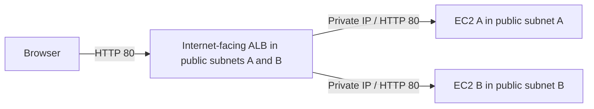

# Assignment 2 — Application Load Balancer

## Objective

Deploy two EC2 web servers behind an internet-facing Application Load Balancer (ALB). Visitors reach the ALB; the instances accept HTTP only from its security group. Use two Availability Zones (AZs), verify both targets are healthy, and collect evidence for your repo.

**Status:** Build guide and planned architecture. No AWS deployment or test results are claimed here.

## Core learning goal

Learn how one internet-facing Application Load Balancer distributes HTTP requests to two EC2 web servers, using a listener, a target group, and health checks. Restrict the servers' inbound HTTP access to the ALB security group.

This is a focused build guide, not a verbatim copy of the course brief. Private subnets and NAT are optional architecture improvements, not requirements for using an ALB. The baseline below uses two public subnets.

- **Listener:** The ALB's entry point for a protocol and port, here HTTP 80.
- **Target group:** The registered web servers and the settings used to route requests to them.
- **Health check:** A periodic request that checks whether a server can serve traffic.

## Architecture plan

| Resource | Suggested name | Configuration |
|---|---|---|
| VPC | `assignment-vpc` | `10.0.0.0/16` |
| Public subnet A | `public-subnet-a` | `10.0.1.0/24`, AZ A |
| Public subnet B | `public-subnet-b` | `10.0.3.0/24`, AZ B |
| Internet Gateway | `assignment-igw` | Attached to the VPC |
| ALB | `assignment2-alb` | Internet-facing, IPv4, public subnets A and B |
| Target group | `assignment2-web-tg` | Instance targets, HTTP 80, same VPC |
| EC2 A | `assignment2-web-a` | Public subnet A, public IPv4 enabled for package downloads |
| EC2 B | `assignment2-web-b` | Public subnet B, public IPv4 enabled for package downloads |
| ALB security group | `assignment2-alb-sg` | Public HTTP entry point |
| EC2 security group | `assignment2-web-sg` | HTTP from ALB SG only |

Use two different Availability Zones in the same Region. You may reuse Assignment 1's VPC and public subnet after checking their configuration and that the suggested CIDRs are available.



The listener forwards to the target group containing A and B. The ALB reaches these instances using their private IP addresses. Their public IPv4 addresses allow outbound package downloads through the Internet Gateway; security groups restrict inbound HTTP to the ALB.

## 1. Prepare the network

1. Reuse a verified VPC or create one for this lab.
2. Prepare two public subnets in different Availability Zones.
3. Confirm an Internet Gateway is attached to the VPC.
4. Associate both subnets with a public route table containing the routes below.

| Destination | Target |
|---|---|
| `10.0.0.0/16` | `local` |
| `0.0.0.0/0` | Internet Gateway |

Use the actual VPC CIDR if yours differs. Enable public IPv4 assignment when launching both instances so their user-data can download Apache. No NAT Gateway or additional private subnet is needed for this baseline.

For this regional ALB, select two subnets in different AZs. AWS specifies at least a `/27` subnet and eight free IP addresses in each ALB subnet for scaling. See [ALB subnet requirements](https://docs.aws.amazon.com/elasticloadbalancing/latest/application/application-load-balancers.html).

**Checkpoint:** Trace browser ? ALB ? EC2. What does the listener do, and which servers belong in the target group?

## 2. Create the security groups

Create these two groups in the same VPC before launching the instances.

| Security group | Direction | Protocol / port | Source or destination |
|---|---|---|---|
| `assignment2-alb-sg` | Inbound | TCP 80 | `0.0.0.0/0` |
| `assignment2-alb-sg` | Outbound | TCP 80 | `assignment2-web-sg` |
| `assignment2-web-sg` | Inbound | TCP 80 | `assignment2-alb-sg` |
| `assignment2-web-sg` | Outbound | All traffic | `0.0.0.0/0` for lab package downloads |

Create both groups first, then add the references. Replace the ALB group's default allow-all outbound rule with the listed HTTP rule. Keep the instance group's default outbound rule for this lab.

For the EC2 inbound source, select **the ALB security group ID**, not its DNS name, your IP, or the VPC CIDR. That rule covers both application requests and the HTTP health checks. Security groups are stateful, so response traffic is automatically allowed.

Do not add public HTTP or SSH rules to the EC2 group. Attach only the intended web group to each instance: rules across multiple attached groups are combined, so another permissive group could undo the isolation. The ALB gets only the ALB group.

See [AWS ALB security group guidance](https://docs.aws.amazon.com/elasticloadbalancing/latest/application/load-balancer-update-security-groups.html).

## 3. Launch the two EC2 instances

Launch instances separately so you can choose their subnets and page labels individually.

1. In **EC2 → Instances → Launch instances**, name the first instance `assignment2-web-a`.
2. Select **Amazon Linux 2023** and an instance size suitable for a small lab. Check pricing and your account's eligibility rather than assuming it is free.
3. Choose your VPC and public subnet A. Set **Auto-assign public IP: Enable**.
4. Select existing security group `assignment2-web-sg`.
5. Under **Advanced details → User data**, add the script below.
6. Launch and repeat for `assignment2-web-b` in public subnet B, changing `SERVER_LABEL` to `Web server B`.

The script runs on the Linux instance, not in Windows PowerShell. It installs Apache, writes an identifiable page, and starts the service. User-data runs as root and normally runs only on first boot. See [EC2 user-data documentation](https://docs.aws.amazon.com/AWSEC2/latest/UserGuide/user-data.html).

```bash
#!/bin/bash
set -euxo pipefail
SERVER_LABEL="Web server A"
dnf install -y httpd
cat > /var/www/html/index.html <<EOF
<!doctype html>
<html lang="en">
<head><meta charset="utf-8"><title>Assignment 2</title></head>
<body>
  <h1>Assignment 2 - ${SERVER_LABEL}</h1>
  <p>Hostname: $(hostname)</p>
  <p>This response came through the Application Load Balancer.</p>
</body>
</html>
EOF
systemctl enable --now httpd
```

| Script section | Purpose |
|---|---|
| `#!/bin/bash` | Run the script with Bash |
| `set -euxo pipefail` | Log commands and stop on failures or unset variables |
| `SERVER_LABEL=...` | Make A and B visibly different |
| `dnf install -y httpd` | Install Apache without an interactive prompt |
| `cat ... <<EOF` | Write the root page; expand the label and hostname |
| `systemctl enable --now httpd` | Start Apache now and enable it on future boots |

The text on the page is a label, not proof of isolation; the networking and security group checks below provide that evidence.

Allow time for bootstrap to finish. An EC2 instance being **Running** does not mean Apache is ready. If installation fails, inspect the public IPv4 assignment, Internet Gateway route, and outbound security group rules and `/var/log/cloud-init-output.log` through an authorized management connection. Changing user-data and rebooting does not normally rerun it.

No SSH access is required for the baseline. For troubleshooting, optionally configure Systems Manager Session Manager with an appropriate instance IAM role, a running SSM Agent, and outbound connectivity to its service endpoints. Do not open public SSH merely to debug this lab. See [Session Manager prerequisites](https://docs.aws.amazon.com/systems-manager/latest/userguide/session-manager-prerequisites.html).

## 4. Create the target group

In **EC2 → Target Groups → Create target group**, use:

| Setting | Value |
|---|---|
| Target type | Instances |
| Name | `assignment2-web-tg` |
| Protocol / port | HTTP / 80 |
| IP address type | IPv4 |
| VPC | Your assignment VPC |
| Protocol version | HTTP1 |
| Health check protocol | HTTP |
| Health check path | `/` |
| Health check port | Traffic port, meaning 80 |
| Success code | `200` |
| Other health check timings | Leave defaults for the baseline |

Select both instances, use port 80, choose **Include as pending below**, and finish creating the group. Verify both appear under **Targets**. Leave stickiness disabled and use the default round-robin routing algorithm for the initial test.

The group must be connected to an ALB listener and both target AZs enabled before the health checks can produce the intended healthy setup. See [target health checks](https://docs.aws.amazon.com/elasticloadbalancing/latest/application/target-group-health-checks.html).

## 5. Create the Application Load Balancer

1. Open **EC2 → Load Balancers → Create load balancer → Application Load Balancer**.
2. Name it `assignment2-alb`.
3. Choose **Internet-facing** and **IPv4**.
4. Select your VPC. Under network mappings, choose **public subnet A and public subnet B**, in their two different AZs.
5. Select `assignment2-alb-sg`, removing any unintended default group.
6. Configure a listener on **HTTP:80**, with default action **Forward to `assignment2-web-tg`**.
7. Create the ALB and wait until its state is **Active**.
8. Open the target group's **Targets** tab and wait for both instances to show **Healthy**.

The ALB and instances use the two public subnets in this baseline; separate private subnets are optional. See the [AWS ALB creation guide](https://docs.aws.amazon.com/elasticloadbalancing/latest/application/create-application-load-balancer.html).

## 6. Test and record evidence

Copy the ALB **DNS name** from its details page. Open `http://YOUR_ALB_DNS_NAME` explicitly with HTTP; HTTPS is a later bonus.

| Test | Expected result | Evidence |
|---|---|---|
| Open ALB DNS name | Web page loads | Browser screenshot with ALB URL |
| Make repeated requests | Both A and B appear across requests | Screenshot of each page or request output |
| Inspect target group | Both targets Healthy on port 80 | Targets tab |
| Inspect listener | HTTP 80 forwards to correct group | Listener details |
| Inspect both instances | Correct public subnet and AZ, public IPv4 assigned | Networking details |
| Inspect all attached EC2 SGs | HTTP allowed only from ALB SG; no public inbound rules | Rules and attachments |
| Try each instance directly at `http://INSTANCE_PUBLIC_IP` | HTTP connection fails because the EC2 SG allows only the ALB SG | Record result and SG evidence |

A timeout alone is not proof of correct access rules. Combine the direct public-IP test with evidence that all attached EC2 security groups allow inbound HTTP only from the ALB security group, while requests through the ALB succeed.

**Do not expect perfect A/B/A/B browser alternation.** Round robin operates within a distributed load balancer, and browser caching can obscure responses. The goal is to observe both distinct servers over multiple fresh requests, with both targets healthy. See [target group routing attributes](https://docs.aws.amazon.com/elasticloadbalancing/latest/application/edit-target-group-attributes.html).

For a clearer test, run this on your Windows computer in **PowerShell**, replacing the DNS placeholder:

```powershell
$albUrl = 'http://YOUR_ALB_DNS_NAME'
1..20 | ForEach-Object {
    curl.exe --silent --show-error --fail "${albUrl}/?request=$_"
}
```

`curl.exe` calls curl rather than a PowerShell alias, and each request adds a query value. The output should contain both labels, though equal counts are not a requirement. If only one appears, check target health, page contents, and stickiness before assuming balancing is broken.

### Optional resilience test

After recording both healthy targets, stop one lab instance and wait for its target health to change. Confirm repeated ALB requests reach the remaining server. Start the stopped instance again and wait for it to become Healthy. Brief errors during detection are possible. Do this before adding Auto Scaling, which may replace stopped instances.

## Troubleshooting: follow the request path

| Symptom | Check first |
|---|---|
| ALB URL times out | Explicit HTTP URL, Active state, internet-facing scheme, public subnet IGW routes, ALB inbound 80 |
| ALB returns 503 | Listener target group, registered targets, whether targets are usable and AZs enabled |
| Target is Unhealthy with timeout | ALB outbound 80, EC2 inbound from ALB SG, Apache listening, any custom network ACLs |
| Health check response code mismatch | `/` returns 200; root page exists; no unexpected redirect or authentication |
| Apache never installed | Instance public IPv4, public subnet route to IGW, instance outbound access, cloud-init log |
| Only one page appears | Both targets healthy, different page contents, stickiness disabled, repeated fresh requests |
| Editing user-data had no effect | User-data normally runs only at first launch; repair via management access or recreate the lab instance |

Read the exact target health reason before changing rules. Do not fix a failed health check by allowing HTTP from everywhere on EC2. See [AWS ALB troubleshooting](https://docs.aws.amazon.com/elasticloadbalancing/latest/application/load-balancer-troubleshooting.html).

## Bonus 1 — Route 53 alias

1. Use a domain you control with a public hosted zone whose name servers are correctly delegated.
2. Create a record such as `app.example.com` with record type **A** and **Alias enabled**. Alias is an option on the record, not a separate DNS record type.
3. Choose **Alias to Application and Classic Load Balancer**, your Region, and this ALB.
4. Save and test `http://app.example.com` after DNS propagation.

Use the ALB alias target instead of copying its current IP addresses. For this IPv4 lab, an A alias is sufficient. See [Route 53 routing to an ELB load balancer](https://docs.aws.amazon.com/Route53/latest/DeveloperGuide/routing-to-elb-load-balancer.html).

## Bonus 2 — HTTPS with ACM

1. Request an ACM public certificate for your domain name in the **same Region as the ALB**.
2. Complete DNS validation and wait for the certificate status to become **Issued**. Keep validation records for renewal.
3. Add inbound TCP 443 from `0.0.0.0/0` to the ALB SG.
4. Add an **HTTPS:443** listener using that certificate and forward to the existing HTTP target group.
5. Test `https://app.example.com`, then change the HTTP:80 listener to redirect to HTTPS:443.
6. Confirm HTTP redirects and the HTTPS certificate matches the custom hostname.

TLS terminates at the ALB in this version; the ALB-to-EC2 connection remains HTTP 80. EC2 still only needs inbound HTTP from the ALB SG. Use your custom domain for certificate testing, not the AWS-generated ALB hostname. See [ALB certificates](https://docs.aws.amazon.com/elasticloadbalancing/latest/application/https-listener-certificates.html).

## Bonus 3 — Auto Scaling Group

1. Create a launch template with the AMI, instance type, web SG, public IPv4 assignment enabled, and web-server user-data. Use the hostname in the page to distinguish automatically created instances.
2. Create an Auto Scaling Group (ASG) across both public subnets; for example, minimum 2, desired 2, maximum 4.
3. Attach the existing target group and enable **Elastic Load Balancing health checks** for the ASG. Choose a grace period long enough for package installation and service startup.
4. Wait until the ASG's two instances are Healthy in the target group. Then deregister the original manually created pair and terminate them after confirming the new pair serves traffic.
5. Test replacement by terminating one ASG-managed lab instance and observing a replacement become healthy.
6. Optionally add a target-tracking policy and record its scaling metric and target. A min/max range alone does not define a load-based scaling policy.

Attaching the target group does not automatically make your original instances ASG-managed. See [attaching load balancing to an ASG](https://docs.aws.amazon.com/autoscaling/ec2/userguide/attach-load-balancer-asg.html).

## Submission and screenshot checklist

Save screenshots in `images/` and your actual observations in [lab-notes.md](lab-notes.md).

1. Architecture diagram with Region, AZs, subnet CIDRs, and traffic flow.
2. `01-subnets.png`: both public subnets and their AZs.
3. `02-public-routes.png`: public routes and both subnet associations.
4. `04-alb-sg.png` and `05-web-sg.png`: the inbound and outbound rules.
5. `06-ec2-a.png` and `07-ec2-b.png`: subnet, AZ, assigned addresses, and attached SGs.
6. `08-alb-details.png`: scheme, DNS name, and both public subnet mappings.
7. `09-listener.png`: HTTP listener forwarding to the target group.
8. `10-health-settings.png` and `11-healthy-targets.png`: root health check and both healthy targets.
9. `12-page-a.png` and `13-page-b.png`: both pages through the same ALB URL.
10. `14-repeated-requests.png`: request output showing both server identities.
11. Access-control notes explaining why direct HTTP to EC2 is blocked while HTTP through the ALB succeeds.
12. Optional bonus evidence: alias record, valid HTTPS and redirect, or ASG replacement.

Record actual results, including failed tests and how you resolved them. Keep credentials, private keys, and session tokens out of screenshots and notes.

## Cleanup

After saving evidence, delete only resources created for this lab that you no longer need:

1. If used, remove the lab ASG and its instances first so they are not recreated; remove the unused launch template afterward.
2. Delete the lab ALB and then its unused target group.
3. Terminate the manually managed lab instances; check for retained EBS volumes.
4. Remove unused lab SGs and, if dedicated to this lab, subnet routes, subnets, the Internet Gateway, and VPC once dependencies are gone.
5. Remove lab-only DNS records and any certificate no longer in use. Keep shared hosted zones and resources used by Assignment 1.

Stopping EC2 alone does not remove ALB, public IPv4, or storage charges. Record your cleanup date in the notes.
