# Project 2: Application Load Balancer

Deploy EC2 web servers behind an internet-facing Application Load Balancer (ALB) across two Availability Zones, restrict the servers to ALB-only HTTP access, and add the three bonus items: a Route 53 alias, an HTTPS listener with ACM, and an Auto Scaling Group (ASG).

**Region:** Europe (Stockholm), `eu-north-1`  
**Availability Zones:** `eu-north-1a`, `eu-north-1b`  
**Evidence dates:** 5–6 October 2026 (DNS and certificate), 10 October 2026 (ASG troubleshooting), 11 October 2026 (final state)

## Contents

- [Architecture](#architecture)
- [Resource inventory](#resource-inventory)
- [VPC, subnets, and routing](#vpc-subnets-and-routing)
- [Security groups](#security-groups)
- [EC2 instances](#ec2-instances)
- [Target group](#target-group)
- [Application Load Balancer](#application-load-balancer)
- [Testing](#testing)
- [Bonus 1: Route 53 alias](#bonus-1-route-53-alias)
- [Bonus 2: HTTPS with ACM](#bonus-2-https-with-acm)
- [Bonus 3: Auto Scaling Group](#bonus-3-auto-scaling-group)
- [Troubleshooting and lessons learned](#troubleshooting-and-lessons-learned)
- [References](#references)

## Architecture

The ALB sits in two public subnets, one per Availability Zone, and forwards to web servers on HTTP 80. The web servers accept HTTP only from the ALB's security group. They have public IPv4 addresses so that user data can download Apache through the Internet Gateway; there is no NAT Gateway in this build.

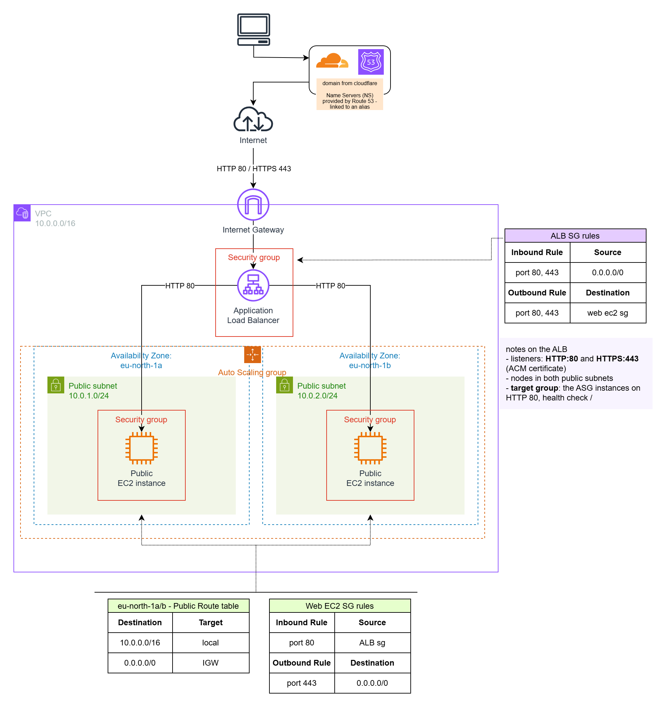

_The solid arrows show the request path. The ALB is drawn above the subnets to keep the diagram readable; its nodes are in both public subnets. The tables give the route table and security group rules._

DNS path: Cloudflare hosts `raiyanrizwan.com` and delegates the `aws` subdomain to a Route 53 hosted zone, where an alias record points `aws.raiyanrizwan.com` at the ALB.

[Open the editable draw.io diagram](AWS-Project2.drawio)

## Resource inventory

All resources are in `eu-north-1`. Identifiers are taken from the screenshots.

| Resource                    | Name or identifier                                   | Availability Zone / scope | CIDR or detail                               |
| --------------------------- | ---------------------------------------------------- | ------------------------- | -------------------------------------------- |
| VPC                         | `my-test-vpc-02` (`vpc-086dfc0e0b0cd2bdd`)           | Regional                  | `10.0.0.0/16`                                |
| Public subnet A             | `my-subnet-a` (`subnet-0d36a551db33a259b`)           | `eu-north-1a`             | `10.0.1.0/24`                                |
| Public subnet B             | `my-subnet-b` (`subnet-04340055d95626512`)           | `eu-north-1b`             | `10.0.2.0/24`                                |
| Internet Gateway            | `tst-vpc-02-igw` (`igw-086134fd4712e07e2`)           | VPC attachment            | N/A                                          |
| Route table A               | `tst02-web-a-rt` (`rtb-0b337782caa6956c4`)           | `my-subnet-a`             | Default route to the IGW                     |
| Route table B               | `tst02-web-b-rt` (`rtb-0b590aebdf44a6d10`)           | `my-subnet-b`             | Default route to the IGW                     |
| ALB security group          | `tst02-alb-sg` (`sg-00066912c9a12b825`)              | VPC                       | N/A                                          |
| Web security group A        | `web-a-sg` / `launch-wizard-1` (`sg-0f9fa97d67f4b0651`) | VPC                    | Used by the launch template                  |
| Web security group B        | `web-b-sg` / `launch-wizard-2` (`sg-0061c4fd867ac8a63`) | VPC                    | Used by the original `tst02-web-b`           |
| Application Load Balancer   | `tst2-alb`                                           | Both subnets              | `tst2-alb-1820820235.eu-north-1.elb.amazonaws.com` |
| Target group                | `tst02-web-tg`                                       | VPC                       | Instance targets, HTTP 80                    |
| Original EC2 A              | `tst02-web-a` (`i-0817501a286276960`), `t3.micro`    | `eu-north-1a`             | Stopped                                      |
| Original EC2 B              | `tst02-web-b` (`i-0f0fb5e7093e69c99`), `t3.micro`    | `eu-north-1b`             | Stopped                                      |
| Launch template             | `tst02-launch-template` (`lt-027e3969a4cf21b23`)     | Regional                  | Version 2 in use                             |
| Auto Scaling Group          | `tst02-web-asg`                                      | Both subnets              | Min 2, desired 2, max 4                      |
| ASG instance A (11 October) | `i-0fafb8532d9189df9`, `c7a.medium`                  | `eu-north-1a`             | Public: `51.20.104.191`                      |
| ASG instance B (11 October) | `i-009b3d95467386301`, `c7a.medium`                  | `eu-north-1b`             | Public: `16.171.13.174`                      |
| Route 53 hosted zone        | `aws.raiyanrizwan.com`                               | Public                    | Alias A record to the ALB                    |
| ACM certificate             | `d1f8c2e8-6e66-4581-90ab-e3ec2d47e8da`               | `eu-north-1`              | `aws.raiyanrizwan.com`, issued 5 October 2026 |

## VPC, subnets, and routing

### VPC

`my-test-vpc-02` uses `10.0.0.0/16`. DNS resolution is enabled; DNS hostnames are disabled.

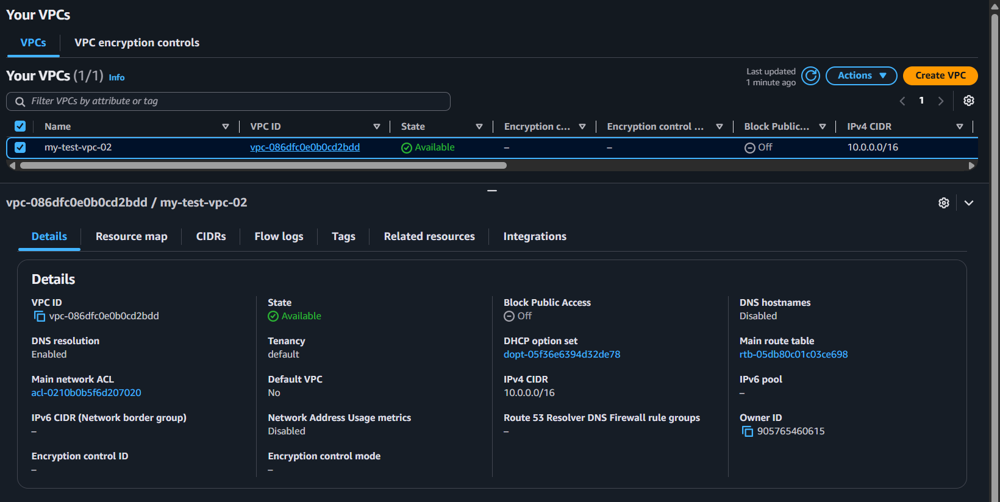

### Subnets, route tables, and Internet Gateway

The resource map shows both subnets, their Availability Zones and CIDRs, the route table each one uses, and the Internet Gateway. It reports "Internet routes to 2 public subnets", so both subnets are public.

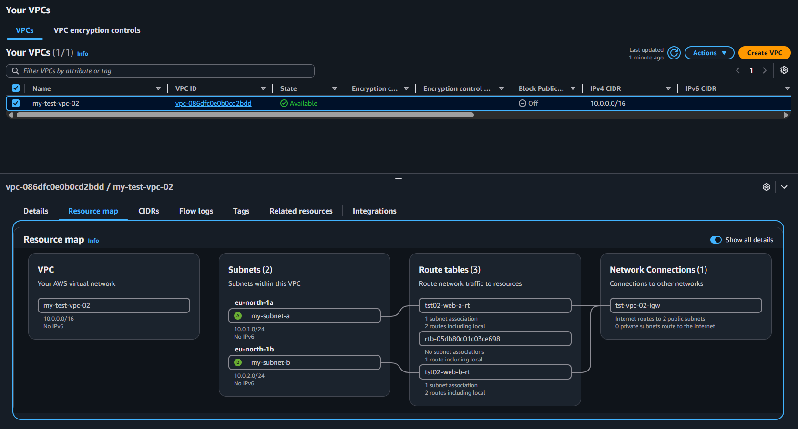

`my-subnet-a` uses `tst02-web-a-rt`, which has the two routes below. `tst02-web-b-rt` is associated with `my-subnet-b`; its routes are not captured separately, but the resource map shows it connected to the same Internet Gateway.

| Destination   | Target                  | Purpose                          |
| ------------- | ----------------------- | -------------------------------- |
| `10.0.0.0/16` | `local`                 | Traffic within the VPC           |
| `0.0.0.0/0`   | `igw-086134fd4712e07e2` | Internet traffic through the IGW |

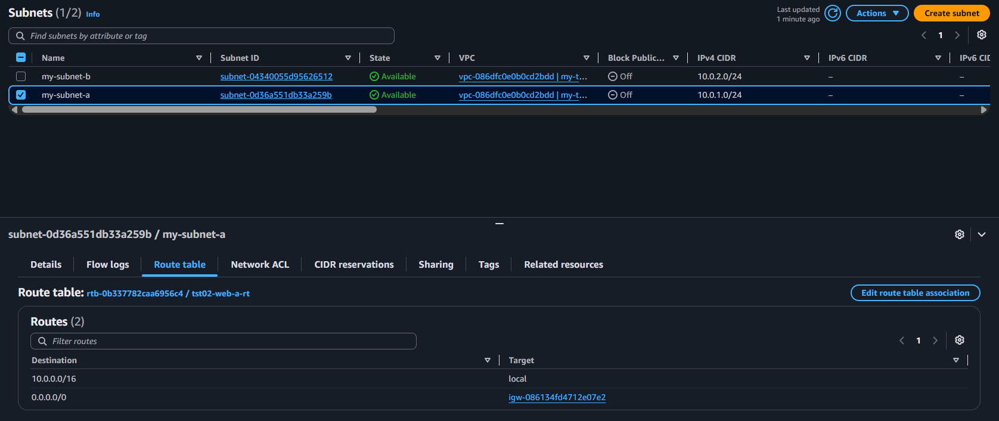

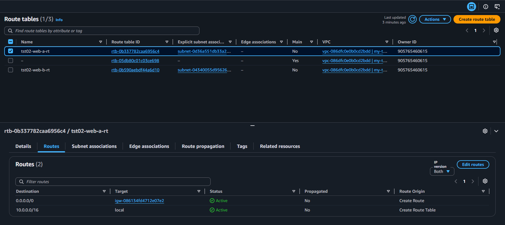

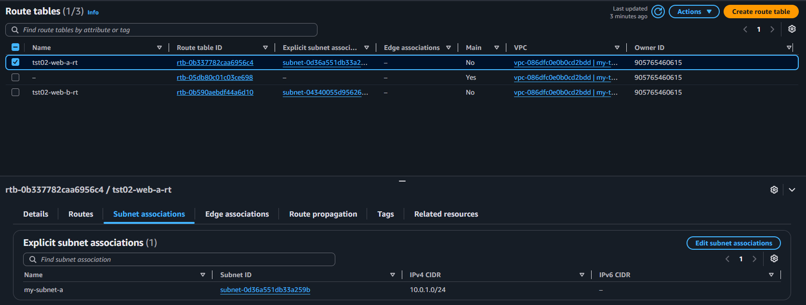

The third route table, `rtb-05db80c01c03ce698`, is the VPC's main table. It has only the local route and no subnet associations.

## Security groups

| Security group | Direction | Protocol / port | Source or destination        | Purpose                               |
| -------------- | --------- | --------------- | ---------------------------- | ------------------------------------- |
| `tst02-alb-sg` | Inbound   | TCP 80          | `0.0.0.0/0`                  | Public HTTP entry point               |
| `tst02-alb-sg` | Inbound   | TCP 443         | `0.0.0.0/0`                  | Public HTTPS entry point (bonus 2)    |
| `tst02-alb-sg` | Outbound  | TCP 80          | `web-a-sg` and `web-b-sg`    | Requests and health checks to targets |
| `tst02-alb-sg` | Outbound  | TCP 443         | `web-a-sg` and `web-b-sg`    | Not used; the targets listen on 80    |
| `web-a-sg`     | Inbound   | TCP 80          | `tst02-alb-sg`               | HTTP from the ALB only                |
| `web-a-sg`     | Outbound  | TCP 443         | `0.0.0.0/0`                  | Package downloads over HTTPS          |

### ALB security group

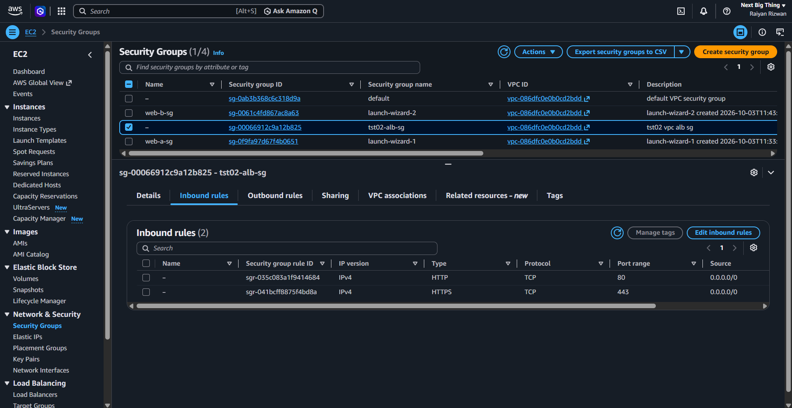

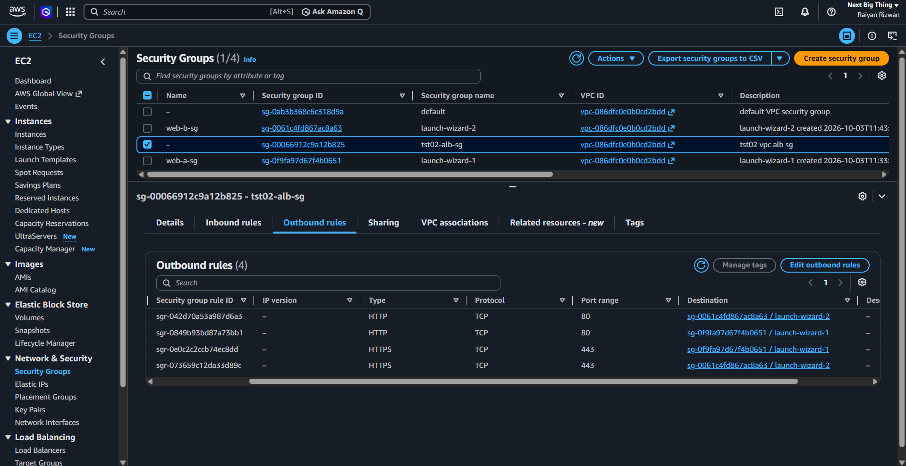

### Web security group

The only inbound rule is HTTP 80 with the ALB security group as its source. There is no rule for my IP, the VPC CIDR, or `0.0.0.0/0`, and no SSH rule.

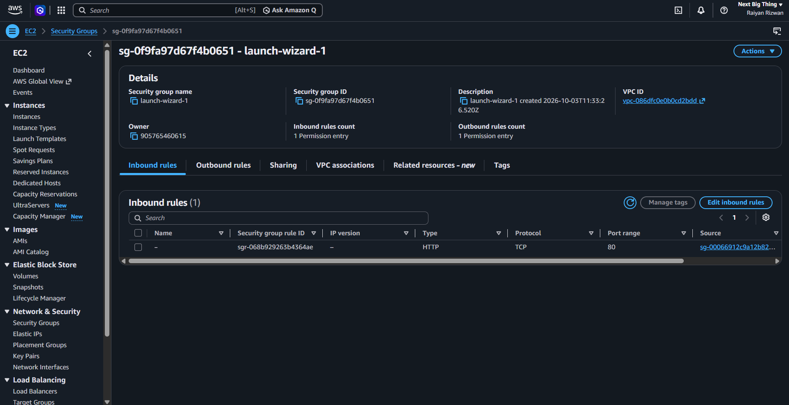

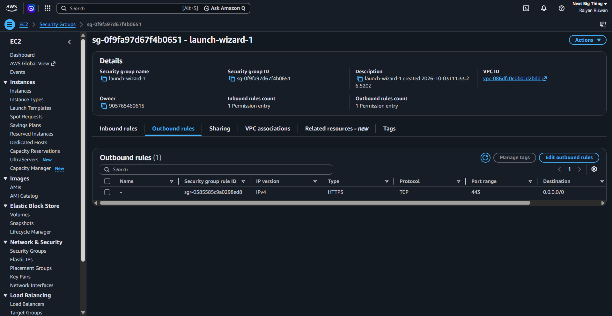

**What I learned:** Using the ALB's security group as the source means "traffic from anything that has this group attached", so it keeps working when the ALB's IP addresses change. It covers both real requests and health checks. Because the instances now have public IPv4 addresses, this rule is the only thing that stops direct access from the internet.

The outbound rule is HTTPS only, which is enough for `dnf` because the Amazon Linux 2023 repositories are served over HTTPS.

_The inbound rules of `web-b-sg` are not captured. It is attached only to the stopped `tst02-web-b`._

## EC2 instances

I first launched two instances by hand, `tst02-web-a` in `eu-north-1a` and `tst02-web-b` in `eu-north-1b`, and registered both in the target group. After adding the Auto Scaling Group I stopped them, so the web servers now running are the two ASG instances. The original pair is still registered and shows as **Unused**.

The web server is installed by user data on first boot. The page prints the instance's hostname, which is how the two servers can be told apart:

```bash
#!/bin/bash
set -euxo pipefail
dnf install -y httpd
cat > /var/www/html/index.html <<EOF
<!doctype html>
<html lang="en">
<head><meta charset="utf-8"><title>Assignment 2</title></head>
<body>
  <h1>Hostname: $(hostname)</h1>
  <p>This response came through the Application Load Balancer.</p>
</body>
</html>
EOF
systemctl enable --now httpd
```

| Script section                 | Purpose                                              |
| ------------------------------ | ---------------------------------------------------- |
| `set -euxo pipefail`           | Log each command and stop at the first failure       |
| `dnf install -y httpd`         | Install Apache without a prompt                      |
| `cat ... <<EOF`                | Write the page; `$(hostname)` is filled in at boot   |
| `systemctl enable --now httpd` | Start Apache now and on every later boot             |

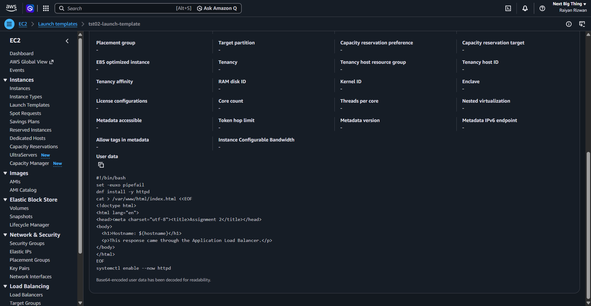

## Target group

`tst02-web-tg` uses instance targets on HTTP 80 with protocol version HTTP1. At capture time it had four registered targets: two healthy ASG instances, one per Availability Zone, and the two stopped originals.

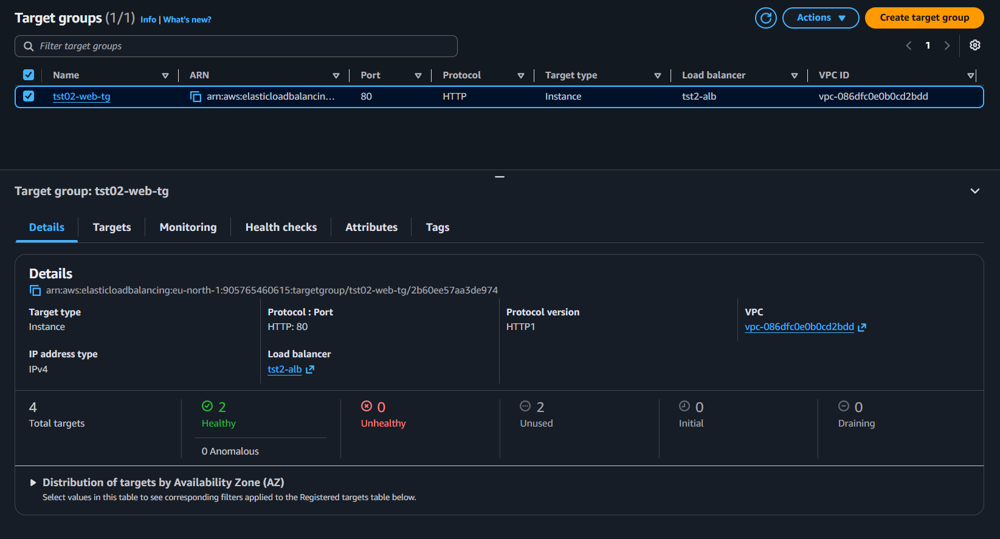

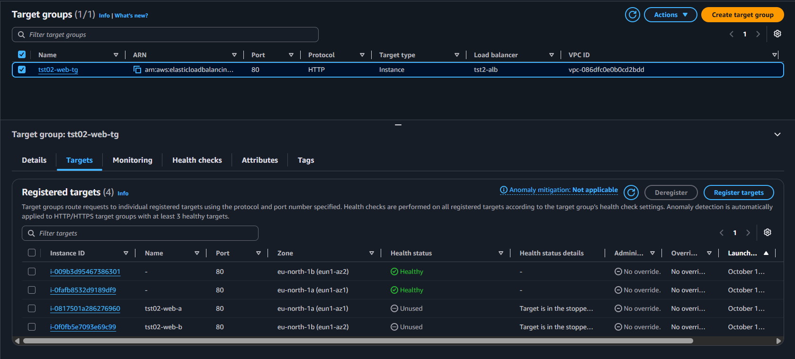

### Health check

| Setting             | Value                 |
| ------------------- | --------------------- |
| Protocol            | HTTP                  |
| Path                | `/`                   |
| Port                | Traffic port (80)     |
| Success codes       | `200`                 |
| Interval / timeout  | 30 seconds / 5 seconds |
| Healthy threshold   | 5 consecutive successes |
| Unhealthy threshold | 2 consecutive failures  |

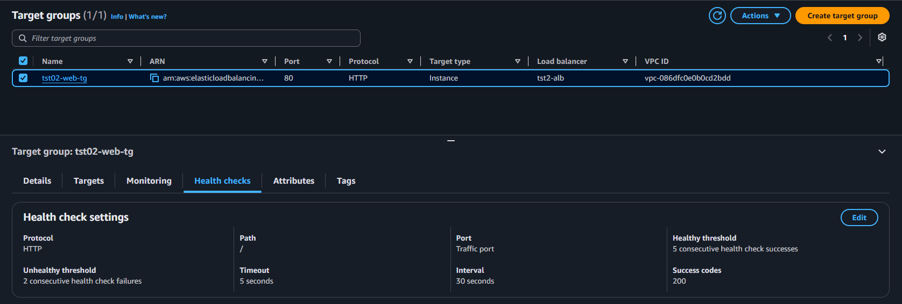

**What I learned:** The health check asks each server for `/` every 30 seconds. A `200` proves Apache is running and reachable from the ALB through the security groups. With these thresholds a broken target is removed after about a minute, while a new one needs five passes, roughly two and a half minutes, before it receives traffic.

## Application Load Balancer

`tst2-alb` is an internet-facing IPv4 Application Load Balancer mapped to both public subnets.

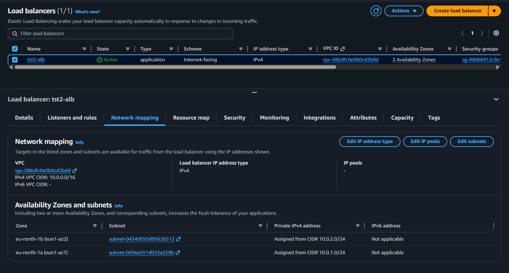

It has two listeners, both forwarding to `tst02-web-tg` with stickiness off:

| Listener    | Default action              | Certificate            |
| ----------- | --------------------------- | ---------------------- |
| `HTTP:80`   | Forward to `tst02-web-tg`   | N/A                    |
| `HTTPS:443` | Forward to `tst02-web-tg`   | `aws.raiyanrizwan.com` |

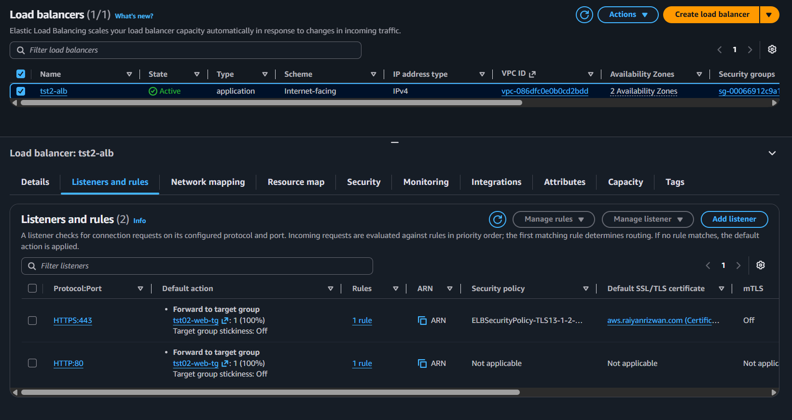

The resource map traces the whole path: listeners, rules, target group, and targets. Both ASG instances are **Healthy**.

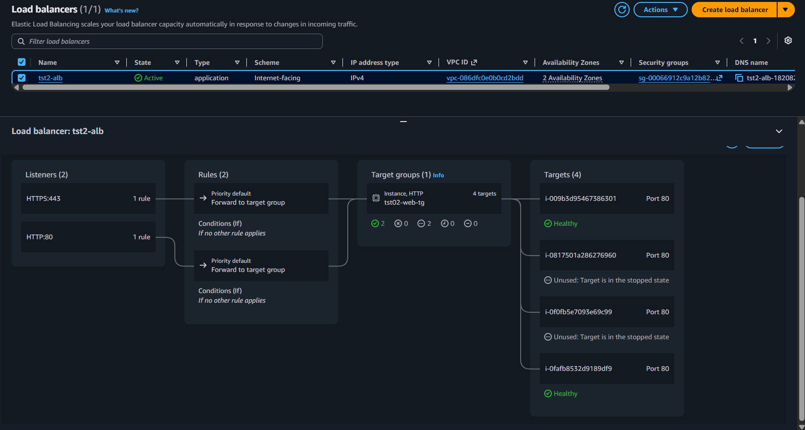

## Testing

### Test 1: Load balancing across both servers

I opened `aws.raiyanrizwan.com` and refreshed. The page was served by two different hosts:

- `ip-10-0-1-228`, an address in `my-subnet-a` (`eu-north-1a`)
- `ip-10-0-2-149`, an address in `my-subnet-b` (`eu-north-1b`)

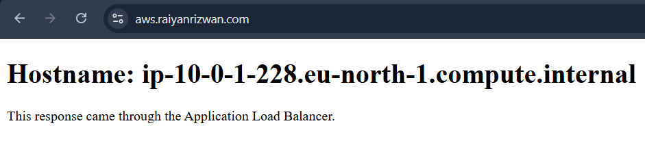

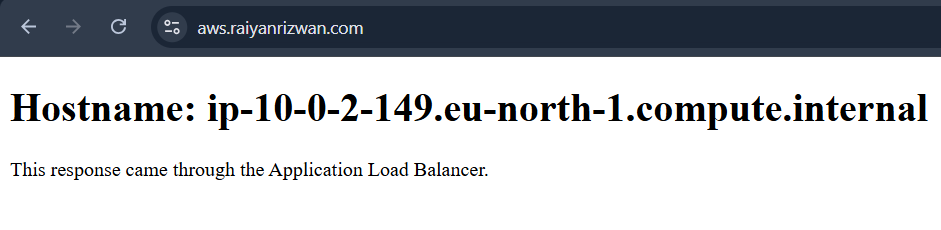

**Result:** Requests through the ALB reach instances in both Availability Zones.

### Test 2: Health checks

**Result:** Both running targets report **Healthy** on port 80 (see the target group and resource map screenshots above).

### Test 3: No direct access to the instances

Both ASG instances have public IPv4 addresses, so I opened each one directly over HTTP:

- `http://51.20.104.191` (instance in `eu-north-1a`)
- `http://16.171.13.174` (instance in `eu-north-1b`)

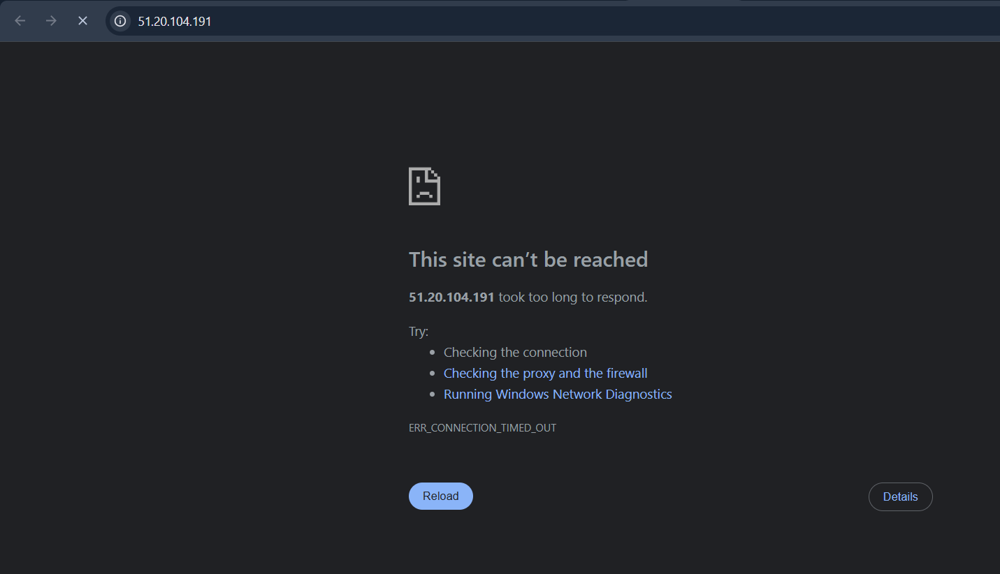

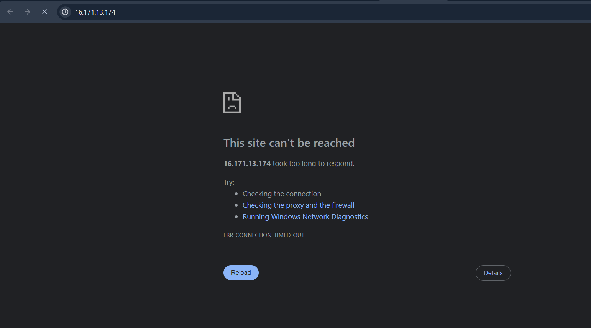

**Result:** Both requests failed with `ERR_CONNECTION_TIMED_OUT`, while the same servers answer through the ALB. A timeout alone could have other causes, so the proof is the combination: the web security group's only inbound rule is HTTP 80 from `tst02-alb-sg`, and the instances are healthy behind the ALB at the same time.

## Bonus 1: Route 53 alias

My domain `raiyanrizwan.com` is hosted on Cloudflare. Rather than moving it, I delegated one subdomain to AWS:

1. Created a public hosted zone in Route 53 for `aws.raiyanrizwan.com`.
2. In Cloudflare, added four **NS** records for `aws` pointing at the hosted zone's name servers, set to DNS only.
3. In the hosted zone, created an **A** record with **Alias** enabled, targeting the ALB.

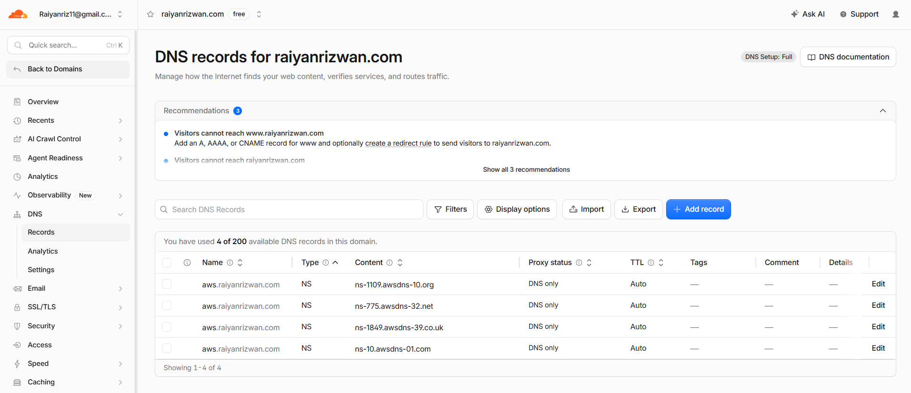

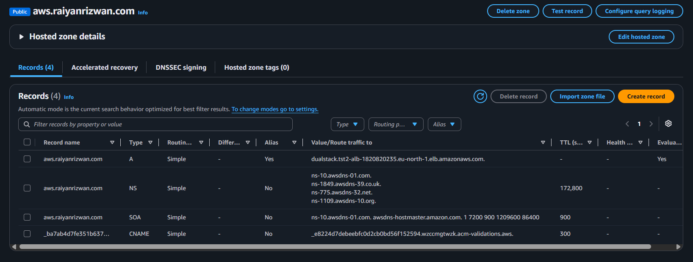

**What I learned:** The NS records hand authority for the subdomain to Route 53, so everything under `aws.raiyanrizwan.com` is answered by AWS while the rest of the domain stays on Cloudflare. An alias record follows the ALB's addresses automatically, which a plain A record with copied IPs would not.

## Bonus 2: HTTPS with ACM

1. Requested a public certificate for `aws.raiyanrizwan.com` in `eu-north-1`, the same Region as the ALB.
2. Validated it by DNS: the validation CNAME is in the Route 53 hosted zone (visible in the records screenshot above).
3. Added inbound TCP 443 to the ALB security group.
4. Added an `HTTPS:443` listener using the certificate, forwarding to the same target group.

The certificate status is **Issued** and **In use**.

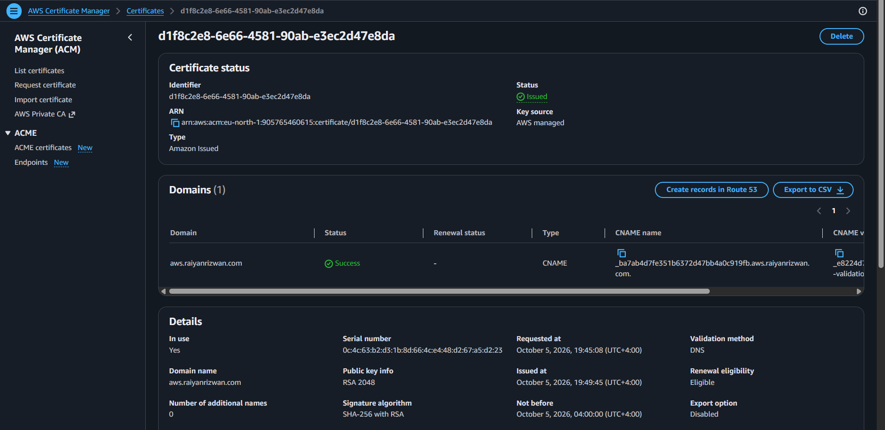

In the browser, the certificate presented for `aws.raiyanrizwan.com` is issued by Amazon and valid from 5 October 2026 to 21 April 2027.

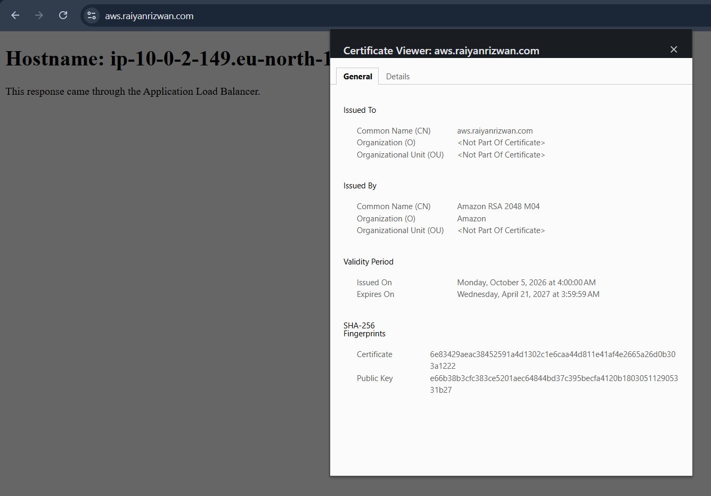

TLS ends at the ALB. The connection from the ALB to the instances is still HTTP 80, so the web security group did not need to change.

_The `HTTP:80` listener still forwards to the target group rather than redirecting to HTTPS, so the site answers on both._

## Bonus 3: Auto Scaling Group

### Launch template

`tst02-launch-template` version 2 defines the Amazon Linux 2023 AMI (`ami-01e082ac2f79f3918`), the web security group (`sg-0f9fa97d67f4b0651`), and the user data shown earlier. The instance type is not set in the template.

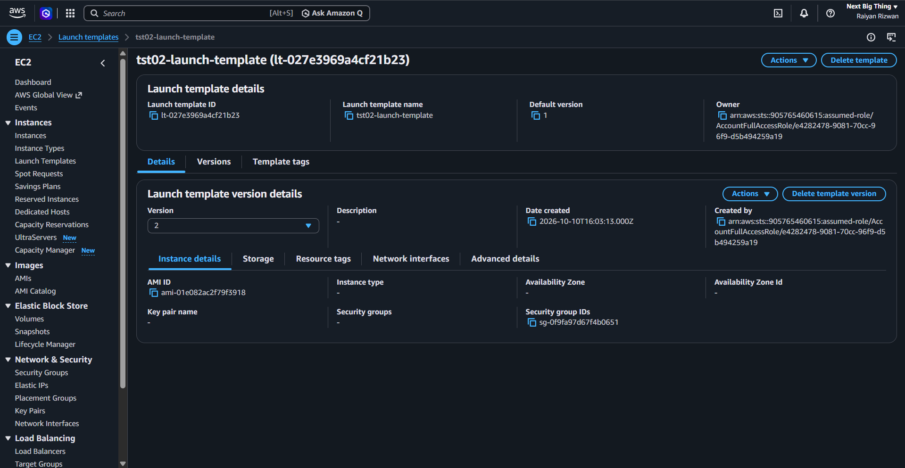

_The template's default version is still 1, which has no security group. The ASG is pinned to version 2, so it is not affected._

### Auto Scaling Group

`tst02-web-asg` was created on 10 October 2026 and uses launch template version 2.

| Setting                 | Value                                                   |
| ----------------------- | ------------------------------------------------------- |
| Capacity                | Minimum 2, desired 2, maximum 4                         |
| Subnets                 | `my-subnet-a` (`eu-north-1a`), `my-subnet-b` (`eu-north-1b`) |
| AZ distribution         | Balanced best effort                                    |
| Instance type selection | Requirements: 0 minimum vCPUs, 0 minimum memory         |
| Purchase option         | 100% On-Demand                                          |
| Status                  | At desired capacity, 2/2 healthy                        |

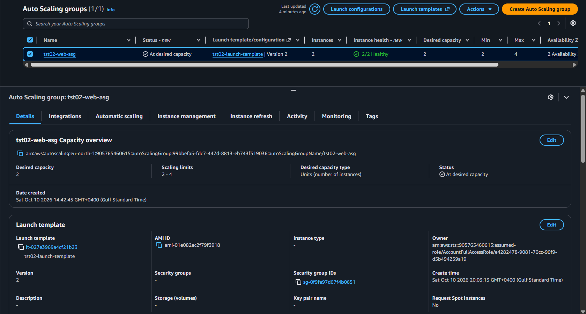

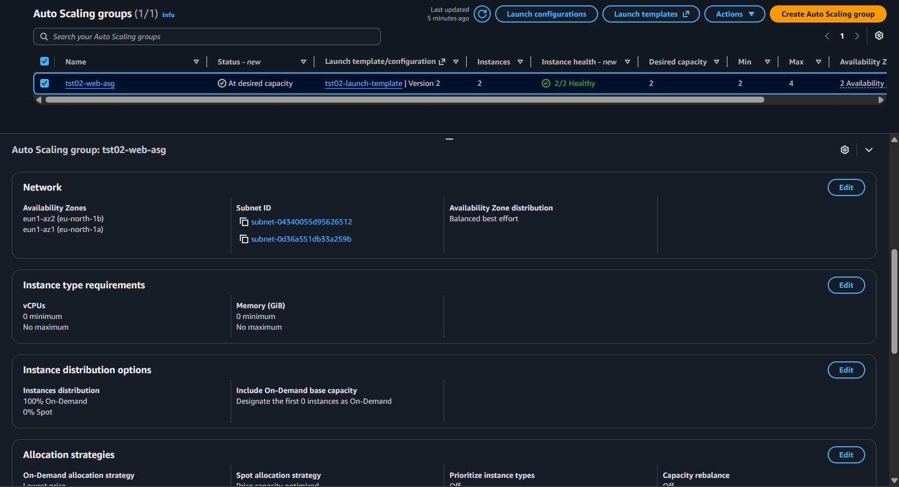

Because the instance type is chosen from requirements instead of being fixed, the ASG picked `c7a.medium`, not the `t3.micro` I used for the original instances.

### Replacement test

To test self-healing I terminated `i-06ed93b0ef5495fb9` in `eu-north-1b` on 11 October. The Activity history shows what the ASG did:

| Time (UTC+4) | Activity                           | Cause recorded by the ASG                                   |
| ------------ | ---------------------------------- | ----------------------------------------------------------- |
| 15:40:36     | Terminating `i-06ed93b0ef5495fb9`  | EC2 health check indicated it had been terminated or stopped |
| 15:40:39     | Launching `i-009b3d95467386301`    | An unhealthy instance needed to be replaced                 |

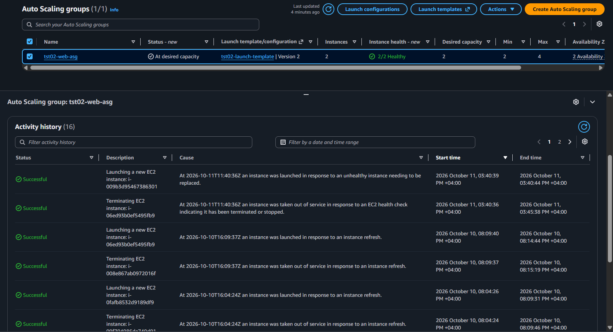

Before the test, the instance in `eu-north-1b` was `i-06ed93b0ef5495fb9`:

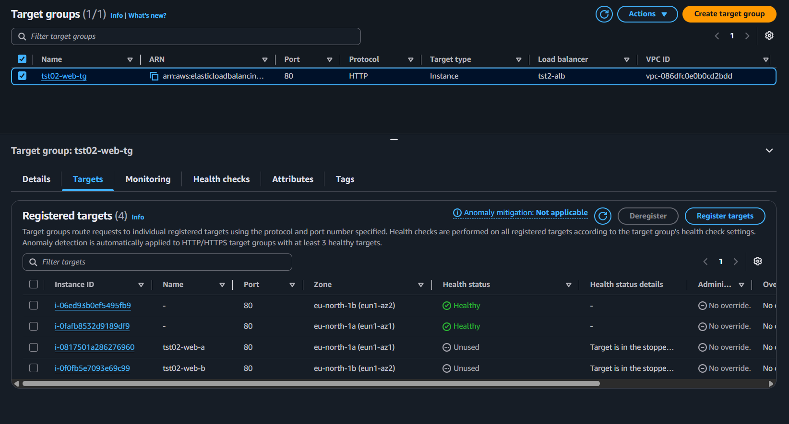

Afterwards it shows as terminated, with `i-009b3d95467386301` running in the same Availability Zone:

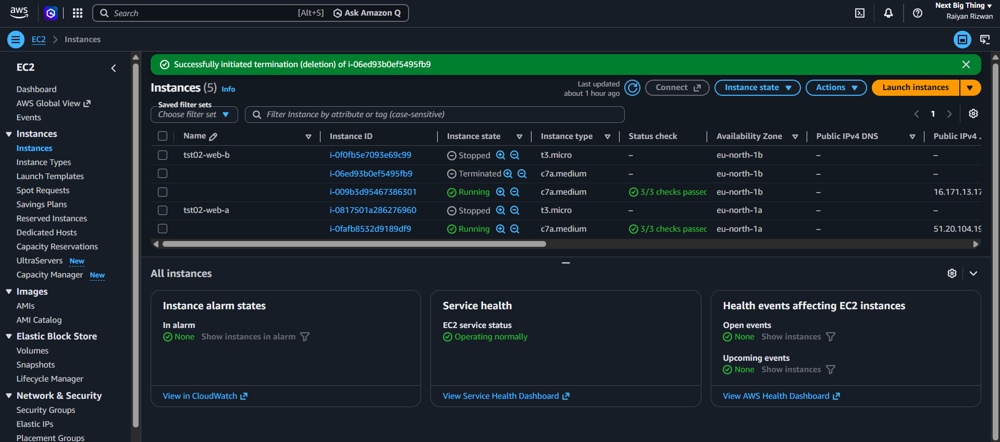

**Result:** The ASG took the terminated instance out of service and launched a replacement in the same Availability Zone three seconds later. It passed its health checks and is the healthy `eu-north-1b` target in the [target group](#target-group) screenshot.

The older rows in the same history are the instance refresh from 10 October, described below.

## Troubleshooting and lessons learned

After I created the ASG and stopped the original instances, the site returned **502 Bad Gateway**. Both ASG instances were unhealthy, so the ALB had no working target. There were two separate causes, and fixing the first exposed the second.

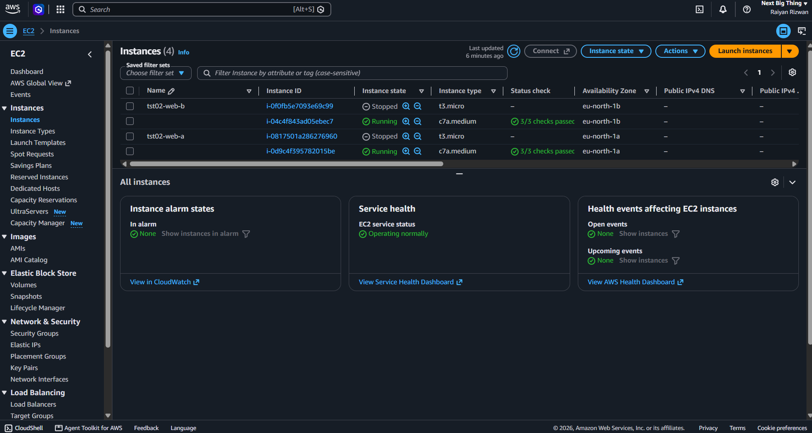

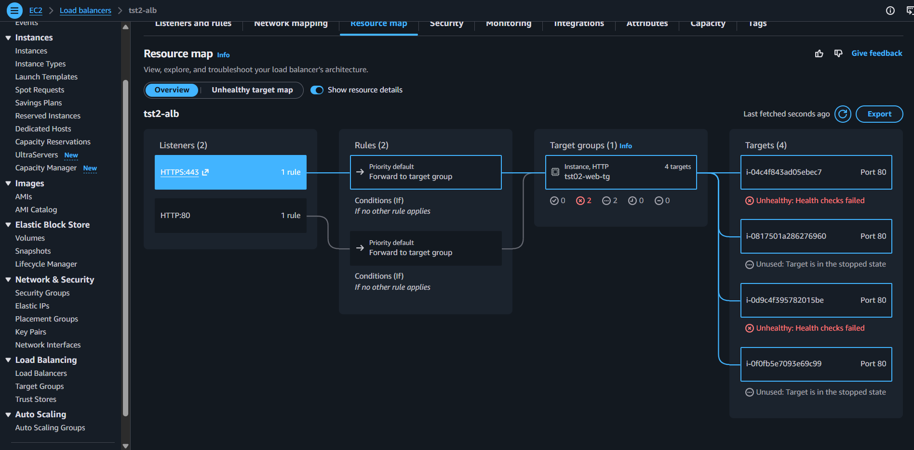

### Problem 1: Apache was never installed

**Evidence:** The instance system log (**Actions → Monitor and troubleshoot → Get system log**) showed user data failing at the first command:

```text
cloud-init: + dnf install -y httpd
cloud-init: Curl error (28): Timeout was reached for https://al2023-repos-eu-north-1-...s3.dualstack.eu-north-1.amazonaws.com/... [Connection timed out after 30000 milliseconds]
cloud-init: Error: Unable to find a match: httpd
cloud-init: Failed to run module scripts-user
```

**Cause:** The instances launched without a public IPv4 address. The subnets are public, but a route to the Internet Gateway is not enough by itself: an instance also needs a public address to use it. With no way out, `dnf` could not reach the package repository, `set -e` stopped the script, and nothing was listening on port 80.

**Fix:** I enabled **Auto-assign public IPv4 address** on the subnets so new instances launch with a public address, then ran an **instance refresh** on the ASG. User data only runs on first boot, so the existing instances had to be replaced rather than repaired.

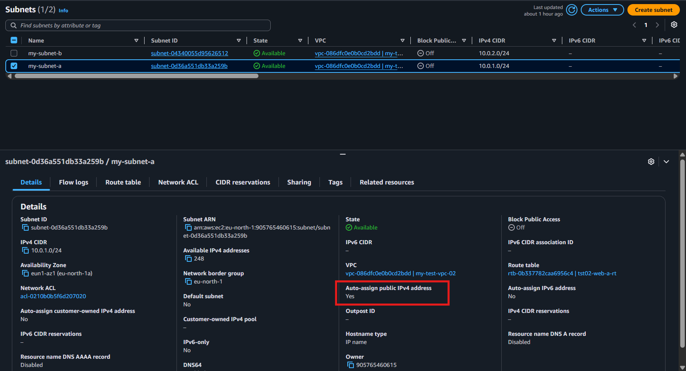

_The screenshot shows `my-subnet-a`. The instance in `my-subnet-b` also has a public address (`16.171.13.174`)._

**Lesson:** "Public subnet" describes the route table, not the instances in it. An instance being **Running** with 3/3 status checks says nothing about whether the application installed. The system log shows user-data output without needing SSH.

### Problem 2: Health checks timed out

**Evidence:** After the refresh the new instances had public IPs, but the target group reported **Unhealthy: Request timed out**. The instance's Security tab showed the VPC's `default` security group, whose only inbound rule allows traffic from the group itself.

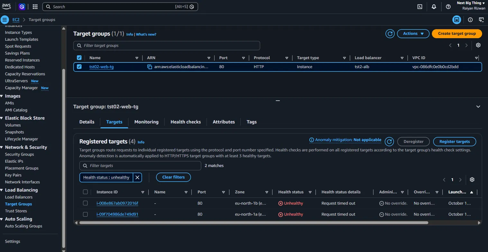

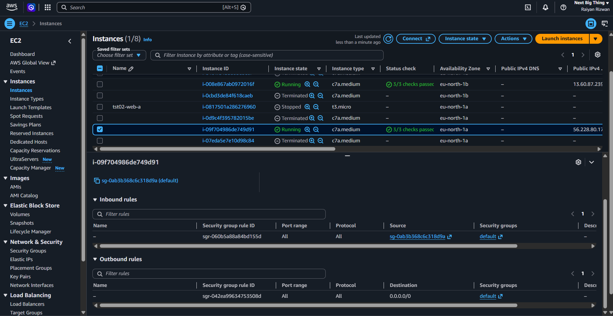

**Cause:** Launch template version 1 had no security group, so instances fell back to the default one and the ALB's requests on port 80 were dropped.

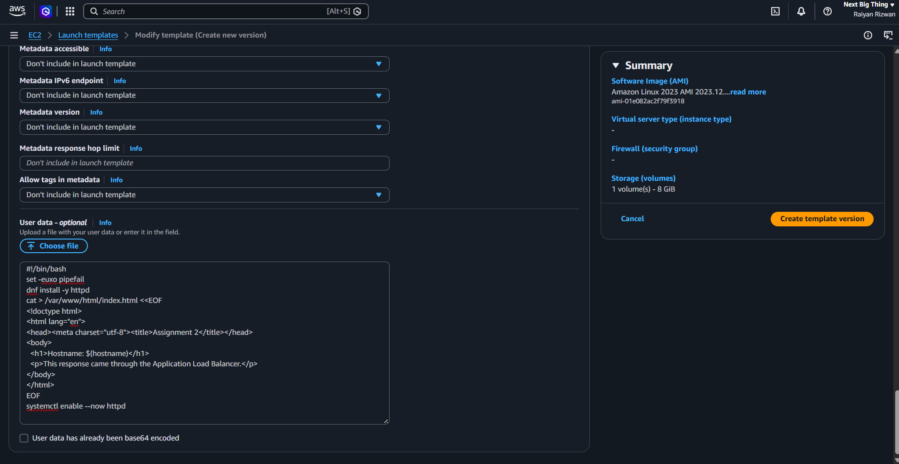

**Fix:** I created launch template version 2 with `web-a-sg`, which allows HTTP 80 from the ALB security group, and replaced the instances with another instance refresh. The [activity history](#replacement-test) shows it on 10 October between 20:04 and 20:15 (UTC+4): the two instances on the default security group were terminated and `i-0fafb8532d9189df9` and `i-06ed93b0ef5495fb9` launched in their place. Both targets became healthy and the site loaded.

**Lesson:** The health status reason points at the layer to inspect. A timeout means packets are being dropped, which usually means a security group; a failed install shows up differently. I did not open port 80 to `0.0.0.0/0` to get past it, because that would have removed the isolation the assignment asks for.

### Other things I learned

- A new launch template version does not change running instances. The ASG has to use the new version, and the instances have to be replaced.
- In an instance refresh, **skip matching** leaves instances alone if they already match the template. That would have replaced nothing in Problem 1, where the template had not changed.

## References

- [AWS: Troubleshoot your Application Load Balancers](https://docs.aws.amazon.com/elasticloadbalancing/latest/application/load-balancer-troubleshooting.html) — what 502, 503, and 504 mean.
- [AWS: Health checks for target groups](https://docs.aws.amazon.com/elasticloadbalancing/latest/application/target-group-health-checks.html) — health status reason codes.
- [AWS: Run commands at launch with user data](https://docs.aws.amazon.com/AWSEC2/latest/UserGuide/user-data.html) — when user data runs and where its output goes.
- [AWS: Attach a load balancer to an Auto Scaling group](https://docs.aws.amazon.com/autoscaling/ec2/userguide/attach-load-balancer-asg.html) — target group registration and ELB health checks.
- [AWS: Routing traffic to an ELB load balancer](https://docs.aws.amazon.com/Route53/latest/DeveloperGuide/routing-to-elb-load-balancer.html) — alias records.
- [AWS: SSL certificates for your Application Load Balancer](https://docs.aws.amazon.com/elasticloadbalancing/latest/application/https-listener-certificates.html) — HTTPS listeners with ACM.
