# Terraform Project 2: EC2 + NGINX with cloud-init

Terraform launches an EC2 instance that configures itself on first boot with cloud-init: it installs NGINX, writes a custom page and starts the web server. No manual steps.

Brief: [project2-description.md](project2-description.md)

> **Status:** complete. Runs A (`user_data`) and B (`user_data_base64`) were applied and verified, then everything was destroyed.

---

## Architecture

```
terraform apply
   │
   ├─ data: aws_ssm_parameter   → latest Amazon Linux 2023 AMI ID
   ├─ data: aws_vpc (default)
   ├─ aws_security_group        → inbound 80 (HTTP) from anywhere, all outbound
   ├─ data: cloudinit_config    → wraps cloud-init.yaml.tftpl
   └─ aws_instance              → user_data = rendered cloud-init
                                       │
                         first boot    ▼
                         cloud-init: install nginx → write index.html → start nginx
                                       │
Browser ── http://<public_ip> ─────────┘
```

- **Region:** `eu-north-1`
- **State:** remote, S3 backend, key `project2/terraform.tfstate` (kept separate from Project 1's key so the two projects don't overwrite each other's state)
- **Access:** no SSH port open. Evidence is gathered from the browser, `curl` and the EC2 serial console output.

---

## Files

| File | Purpose |
|---|---|
| `provider.tf` | `terraform {}` block: pinned `aws` and `cloudinit` providers, S3 backend; `provider "aws"` region |
| `main.tf` | AMI lookup, default VPC, security group + rules, `cloudinit_config`, EC2 instance |
| `variables.tf` | `page_title` input; `all_ip` local |
| `outputs.tf` | `web_ip`, `web_url` |
| `cloud-init.yaml.tftpl` | The `#cloud-config` template Terraform renders into user data |
| `terraform.tfvars` | Local values. Gitignored, never committed |

---

## How cloud-init works

cloud-init is the agent that runs on an instance's **first boot**. It reads the user data EC2 hands it and configures the machine.

A `#cloud-config` file is **declarative**: it describes the end state (these packages, these files) and cloud-init works out the steps. A bash user-data script is **imperative**: you write every step yourself.

### The config, line by line

```yaml
#cloud-config                 # required first line, or cloud-init ignores the file

package_update: true          # refresh the package index (dnf makecache) before installing
packages:                     # list of packages dnf installs; installs only, doesn't start them
  - nginx                     # one package per line

write_files:                  # files cloud-init creates on disk
  - path: /usr/share/nginx/html/index.html   # full path: nginx web root + file name
    permissions: "0644"       # file mode as a quoted string
    defer: true               # write AFTER packages install, so the nginx package can't overwrite it
    content: |                # file contents; | keeps line breaks; indent the lines below it
      <h1>${page_title}</h1>
      <p>Deployed by Terraform + cloud-init</p>

runcmd:                       # shell commands run once, as root, near the end of first boot
  - systemctl enable --now nginx   # start nginx now and on every reboot
```

### Gotchas

- **`#cloud-config` must be the exact first line.** Without it the file isn't treated as cloud-config.
- **`write_files` normally runs before `packages`.** Without `defer: true`, the nginx package would install its own `index.html` over ours.
- **`runcmd` already runs as root**, so no `sudo`.
- **YAML is indentation-sensitive.** Use spaces, never tabs.
- **cloud-init runs once per instance.** Changing the config on an existing instance does nothing. That's why `user_data_replace_on_change = true` is set: a config change replaces the instance so cloud-init runs again.

---

## Terraform → cloud-init workflow

1. **`templatefile()`** fills the `${page_title}` placeholder in `cloud-init.yaml.tftpl` with `var.page_title`.
   - A literal `${` in a template would need escaping as `$${`.
   - Preview the rendered output before applying: run `terraform console`, then type `data.cloudinit_config.nginx.rendered`.
2. **`cloudinit_config`** (from the `hashicorp/cloudinit` provider) wraps the YAML as a **MIME multipart** document.
   - MIME is the email "several labelled parts in one message" format.
   - Each `part {}` has a `content_type` (`text/cloud-config`, `text/x-shellscript`, …) and cloud-init handles each part by its type.
   - This lets one user-data slot carry several configs or scripts.
3. **`aws_instance`** receives the result as `user_data` or `user_data_base64` (see below).
4. **EC2** stores the user data (16 KB limit) and serves it to the instance through the instance metadata service (IMDSv2 required).
5. **cloud-init** reads it on first boot and applies it.

### `user_data` vs `user_data_base64`

| Run | Configuration | What Terraform sends |
|---|---|---|
| **A: plain** | `user_data = templatefile(...)` | Plain YAML. The provider base64-encodes it for the EC2 API automatically |
| **A2: MIME** | `cloudinit_config` with `gzip = false`, `base64_encode = false` → `user_data` | Plain-text MIME document with the YAML inside |
| **B: gzip + base64** | `cloudinit_config` with `gzip = true`, `base64_encode = true` → `user_data_base64` | Compressed binary, already base64-encoded |

- **`user_data`** is for text. Terraform does the encoding.
- **`user_data_base64`** is for content that's already base64. Gzipped output is binary, so it has to be encoded first.
  - Passing it to `user_data` instead would base64-encode it twice.
  - `gzip = true` requires `base64_encode = true`.
- **Why gzip:** it fits larger configs under the 16 KB user-data limit. cloud-init detects and decompresses it itself.

---

## Run it

```bash
terraform init      # downloads aws + cloudinit providers, connects the S3 backend
terraform fmt
terraform validate
terraform plan -out=tfplan
terraform apply tfplan
```

Allow 1–2 minutes after `Apply complete` for cloud-init to finish before opening `web_url`.

`terraform.tfvars` (gitignored):

```hcl
page_title = "..."
```

---

## Verify

From your own machine (no login to the instance needed):

```bash
curl -I http://<web_ip>
```

Expect `HTTP/1.1 200 OK` and `Server: nginx`.

The cloud-init result is written to the serial console:

```bash
aws ec2 get-console-output --instance-id <id> --latest --region eu-north-1 --output text
```

Look for the `Cloud-init v. ... finished at ...` line.

---

## Evidence

### Run A: `user_data`
- [x] Code: `templatefile()` passed straight to `user_data`
- [x] `terraform plan`: `user_data` shown as readable YAML
- [x] `terraform apply` output
- [x] Browser showing the page at `web_url`
- [x] `curl -I` showing `Server: nginx`
- [x] Console output: cloud-init finished
- [x] EC2 console → Actions → Instance settings → Edit user data: readable YAML

**Code:** the rendered template goes straight into `user_data`. No `cloudinit_config`, no manual encoding.

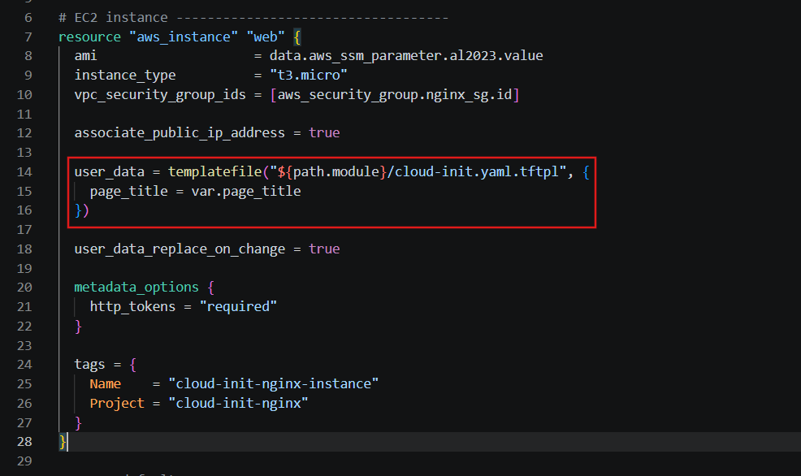

**Plan:** `user_data` is plain YAML, with `${page_title}` already filled in at plan time. `user_data_base64` is `(known after apply)` because the provider does the encoding itself.

```text
+ user_data                            = <<-EOT
      #cloud-config

      package_update: true
      packages:
        - nginx

      write_files:
        - path: /usr/share/nginx/html/index.html
          permissions: "0644"
          defer: true
          content: |
            <h1>My Nginx Server</h1>
            <p>Deployed by Terraform + cloud-init</p>

      runcmd:
        - systemctl enable --now nginx
  EOT
+ user_data_base64                     = (known after apply)
+ user_data_replace_on_change          = true
```

**Apply:** 4 resources created. The instance was ready in 15 s, but cloud-init still had to run after that.

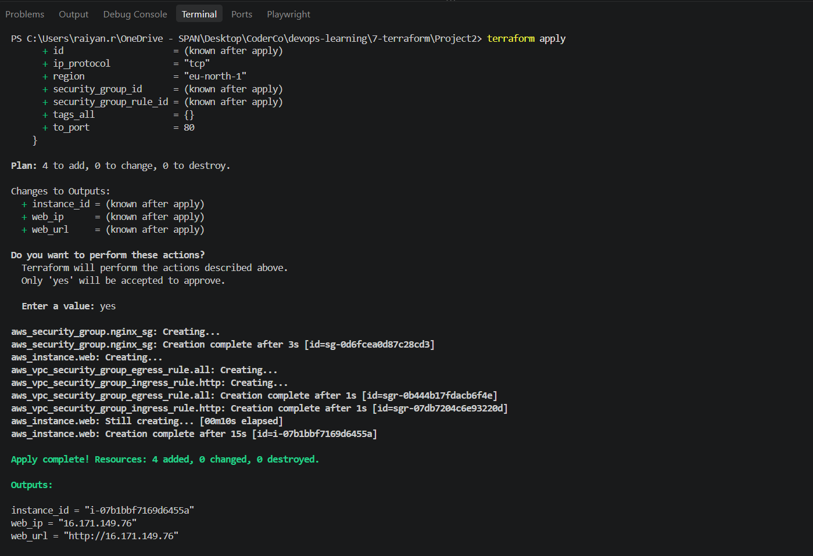

**Browser:** the page served by NGINX on first boot, with no manual steps.

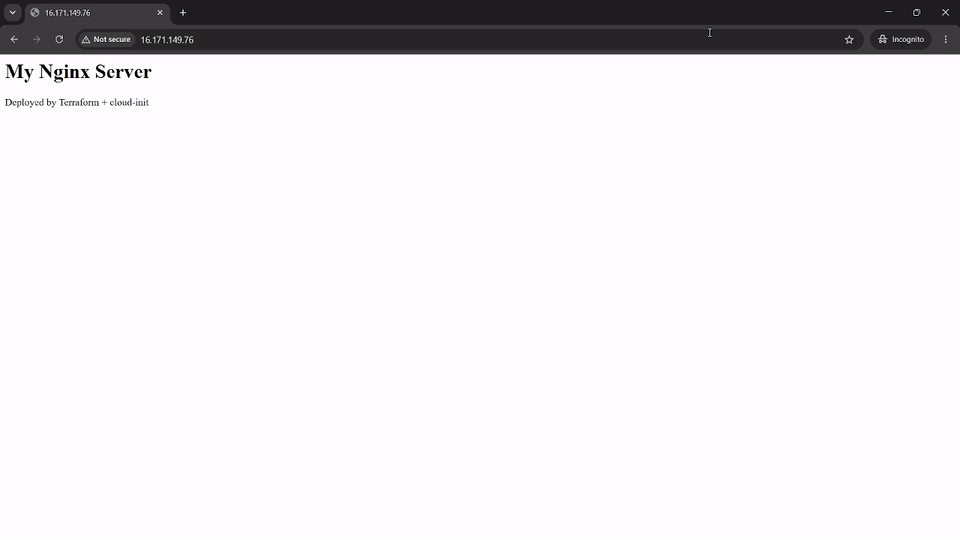

**curl:** `200 OK` from `nginx/1.30.6`. `Last-Modified: 10:38:55` is one second before cloud-init finished (`10:38:56`), so the deferred `write_files` wrote the page at the very end of the final stage.

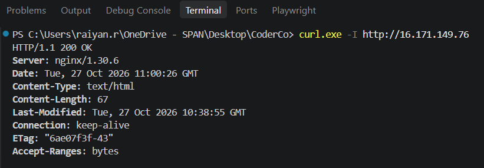

**System log** (EC2 → instance → Actions → Monitor and troubleshoot → Get system log): cloud-init finished 35 s after boot.

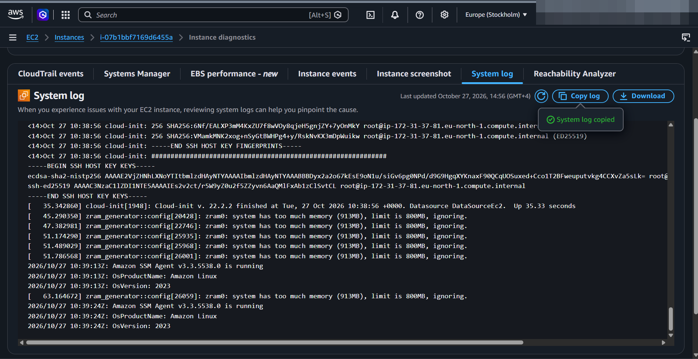

**Edit user data:** AWS stored the YAML exactly as Terraform rendered it, in readable form.

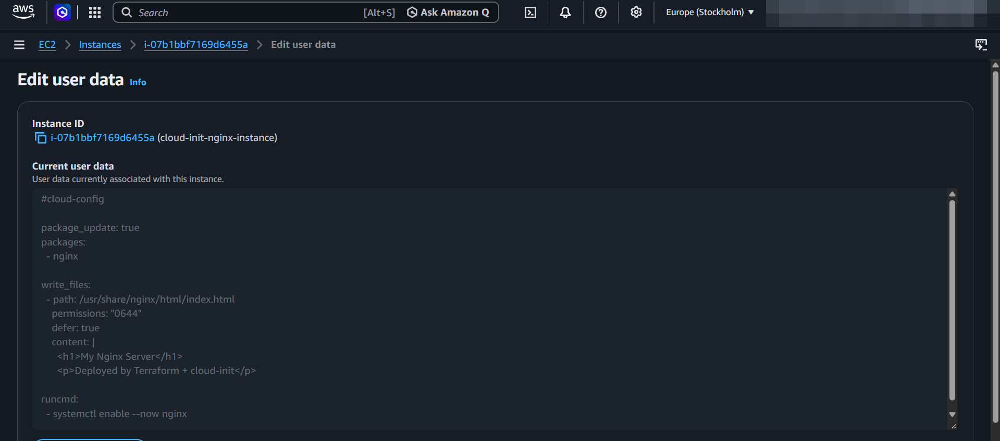

### Run B: `user_data_base64` (gzip)
- [x] Code: `cloudinit_config` with `gzip` + `base64_encode`, passed to `user_data_base64`
- [x] `terraform plan`: `user_data_base64` as an encoded blob and `must be replaced`
- [x] Blob decoded locally: MIME wrapper around the same cloud-config
- [x] `terraform apply` output
- [x] Browser showing the new page title at the new `web_url`
- [x] `curl -I` showing `Server: nginx`
- [x] Console output: cloud-init finished (it decompressed the payload itself)
- [x] EC2 console → Edit user data: can't be decoded (compare with run A)

**Code:** the template is now wrapped by `cloudinit_config`, which gzips it and base64-encodes it, so it goes to `user_data_base64`. `page_title` was changed to `My Nginx Server (gzip + base64 encoded)` so the page proves this is the new instance.

```hcl
resource "aws_instance" "web" {
  # ...
  user_data_base64            = data.cloudinit_config.nginx.rendered
  user_data_replace_on_change = true
}

data "cloudinit_config" "nginx" {
  gzip          = true
  base64_encode = true # required when gzip = true: compressed output is binary

  part {
    content_type = "text/cloud-config"
    content = templatefile("${path.module}/cloud-init.yaml.tftpl", {
      page_title = var.page_title
    })
  }
}
```

**Plan:** only the instance is replaced (`1 to add, 0 to change, 1 to destroy`). Both user-data fields force the replacement: the old YAML in `user_data` goes to `null`, and `user_data_base64` becomes an unreadable blob. It starts with `H4sI`, which is how gzip data always looks once base64-encoded.

```text
# aws_instance.web must be replaced
-/+ resource "aws_instance" "web" {
      - user_data                            = <<-EOT # forces replacement
            #cloud-config
            ...
        EOT -> null
      + user_data_base64                     = "H4sIAAAAAAAA/2SRT4/TMBDF75byHUbhAlp5vZWqRQolErA9cEiRoCBxqpx4kljEfzR2aIL48MgNhFZ788z8PM/v+YOzEW3kx9ljAWYcovaSojB6QvUGajdaJWl+m1cfq/37T18PT+8+f89Zqvg3pKCdLWBz/5CxjHF+DWVs3U3ShhaJ723jlLZdAa9rHa+Ai3jEKYpmcKPijbOt7jJWaYPPZF7cMhnzsvkhOzyNXsmYFtGIazcUGQPgYDttp0SfSUc8tXpYR17GvgAxBhKhl4Tiwoo+mkFoq3C6T8fEAngko0N6Tyggf3jcbvNloLBF+qedGs1iroDfSw2w6zdlNcMhbYcvSD+R4GX3S3u4g1oGfNwCpoRQvdqJflOu93z5hH5wMyqoZzgikWwdGbiDJQptddwJXyZ7NNrGqL/OwhwimiYOgFbWAwLn1p3/Z3H7Y5xn7E8AAAD//zesOCsQAgAA" # forces replacement

Plan: 1 to add, 0 to change, 1 to destroy.
```

**Decoding the blob** (Git Bash): reversing the steps shows exactly what the instance receives. base64-decode, then gunzip:

```bash
echo '<user_data_base64 value from the plan>' | base64 -d | gunzip
```

```text
Content-Type: multipart/mixed; boundary="MIMEBOUNDARY"
MIME-Version: 1.0

--MIMEBOUNDARY
Content-Transfer-Encoding: 7bit
Content-Type: text/cloud-config
Mime-Version: 1.0

#cloud-config

package_update: true
packages:
  - nginx

write_files:
  - path: /usr/share/nginx/html/index.html
    permissions: "0644"
    defer: true
    content: |
      <h1>My Nginx Server (gzip + base64 encoded)</h1>
      <p>Deployed by Terraform + cloud-init</p>

runcmd:
  - systemctl enable --now nginx

--MIMEBOUNDARY--
```

It's the same cloud-config as run A, inside one `text/cloud-config` MIME part. The pipeline is: `templatefile` → MIME wrap → gzip → base64 → EC2 → cloud-init reverses it on boot.

**Apply:** the old instance is destroyed (21 s), then the new one is created (14 s). The security group and its rules are untouched.

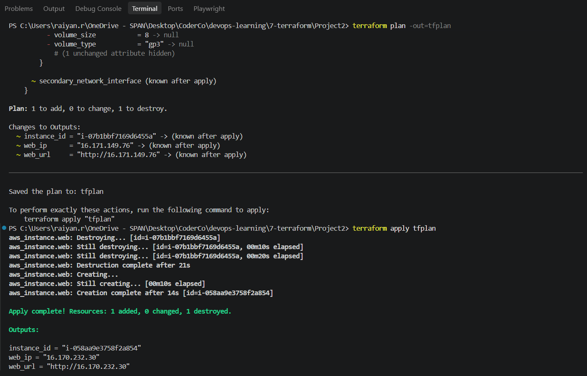

**Browser:** the new title at the new IP.

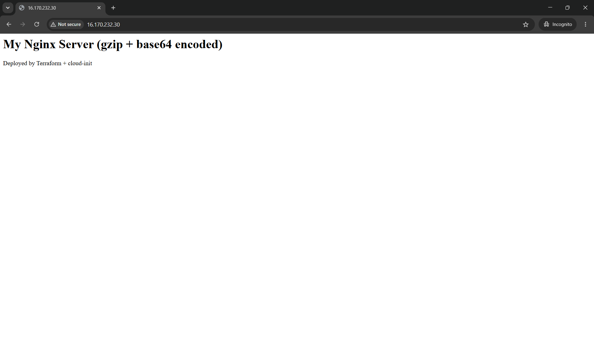

**curl:** `200 OK` from `nginx/1.30.6`. `Last-Modified: 11:58:44` is again one second before cloud-init finished (`11:58:45`), the same timing as run A.

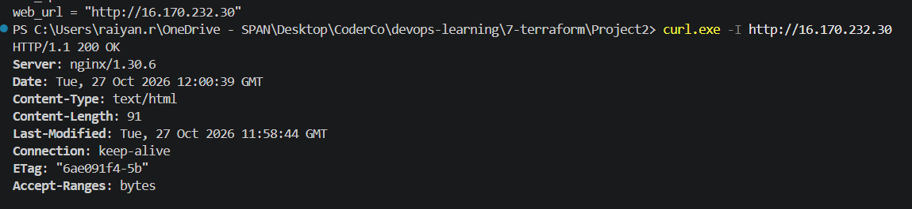

**System log:** cloud-init finished 35.34 s after boot, almost identical to run A's 35.33 s. cloud-init detected the gzip and decompressed it itself, with no extra config.

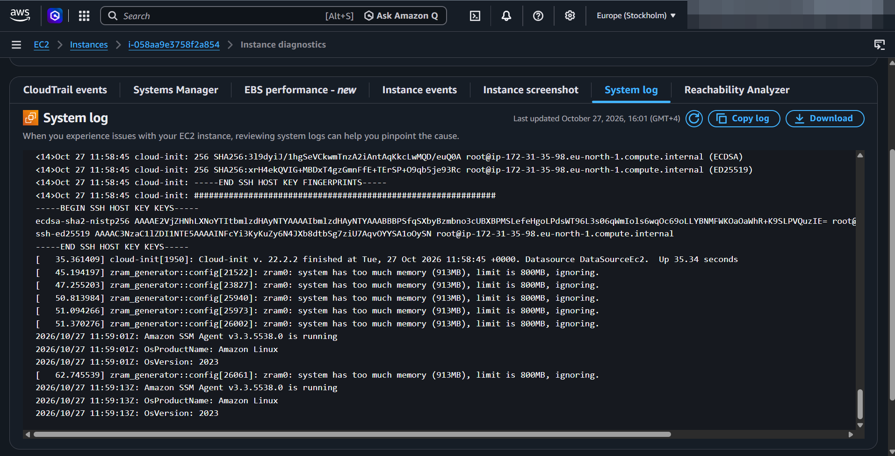

**Edit user data:** the console shows **"Unable to decode user data"** and **"No user data found"**. The console can base64-decode user data for display, but it doesn't gunzip it. The data is there (the instance used it); only the console can't display it. EC2 just stores and delivers user data. The instance's cloud-init is what understands the format.

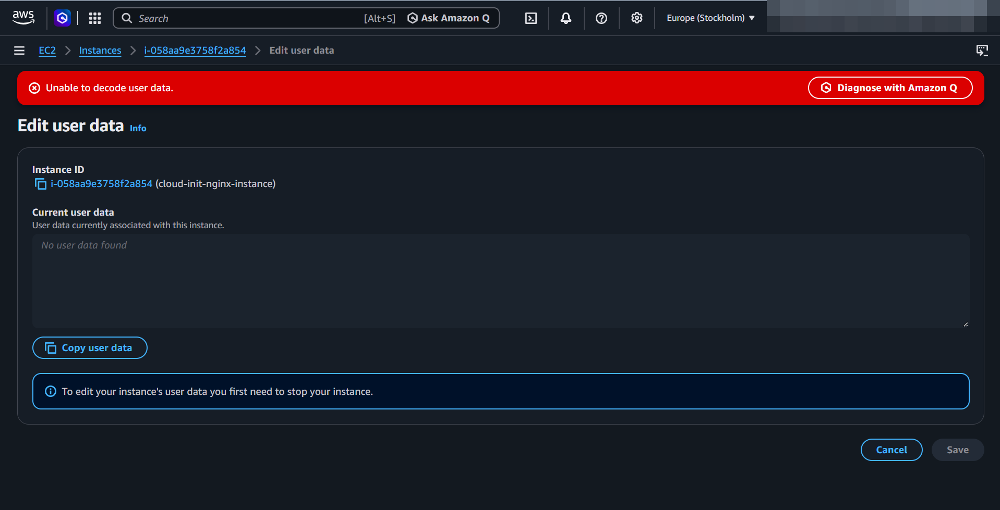

**A vs B in one line:** same config and same result, but run A's user data is readable in the plan and the console, while run B's is compressed and only cloud-init can read it.

### Cleanup
- [x] `terraform destroy` output

All 4 resources destroyed. Terraform destroyed them in reverse dependency order: the two SG rules and the instance first (in parallel), then the security group once nothing referenced it.

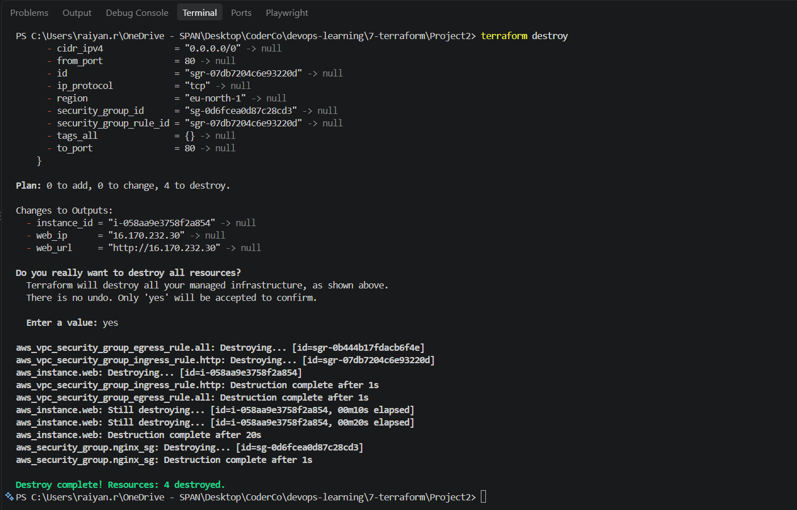

---

## Troubleshooting log

Real problems hit while building this:

1. **`AccessDeniedException ... ssm:GetParameter`** during `terraform plan`.
   - **Cause:** the `terraform-test` IAM user had no SSM permissions. The AMI lookup reads a public SSM parameter.
   - **Fix:** an inline policy allowing `ssm:GetParameter` on `arn:aws:ssm:eu-north-1:*:parameter/aws/service/ami-amazon-linux-latest/*`.
   - Public AWS parameters have an **empty account field** in their ARN (`::`), so an ARN containing your own account ID won't match them.
2. **Still denied after adding the policy.**
   - **Cause:** the policy allowed `ssm:GetParameters` (plural). That's a separate action from `ssm:GetParameter`, which is what Terraform and the CLI call.
   - **How it was found:** reading the policy JSON in the IAM Policy Simulator.
3. **The CLI test returned the wrong resource, `parameter/C`.**
   - **Cause:** Git Bash (MSYS) path conversion rewrote `/aws/service/...` into a Windows path before the AWS CLI saw it.
   - **Fix:** prefix the command with `MSYS_NO_PATHCONV=1`, or run it in PowerShell.
   - Terraform isn't affected, because the path lives in HCL, not on the command line.
4. **`cloudinit_config` needs its own provider.**
   - It's `hashicorp/cloudinit`, not part of the AWS provider.
   - It's declared and pinned in `required_providers`, and `terraform init` is re-run so the lock file includes it.
5. **`aws ec2 get-console-output` failed with `'charmap' codec can't encode character '→'`.**
   - **Cause:** the console log contains a `→`. It comes from our own `runcmd`: `systemctl enable` prints `Created symlink ... → ...`. The AWS CLI on Windows writes to the terminal using the old Windows code page (cp1252), which has no `→`, so it crashed before printing anything.
   - **Tried, didn't fix it:** `$env:PYTHONIOENCODING = "utf-8"`, `$env:PYTHONUTF8 = "1"`, `chcp 65001`. AWS CLI v2 bundles its own Python, which didn't pick these up.
   - **Worked:** reading the same log in the EC2 console instead: **Actions → Monitor and troubleshoot → Get system log**.
   - It's a local display problem only. The instance and the command itself were fine.

---

## Cleanup

```bash
terraform destroy
```

The instance and its public IPv4 address are billed hourly, so destroy when done.

---

## Docs used

- cloud-init user data formats: https://cloudinit.readthedocs.io/en/latest/explanation/format.html
- cloud-init modules (packages, write_files, runcmd): https://cloudinit.readthedocs.io/en/latest/reference/modules.html
- `templatefile`: https://developer.hashicorp.com/terraform/language/functions/templatefile
- `cloudinit_config`: https://registry.terraform.io/providers/hashicorp/cloudinit/latest/docs/data-sources/config
- `aws_instance` (`user_data`, `user_data_base64`, `user_data_replace_on_change`): https://registry.terraform.io/providers/hashicorp/aws/latest/docs/resources/instance
- EC2 user data: https://docs.aws.amazon.com/AWSEC2/latest/UserGuide/user-data.html
- AL2023 AMI SSM parameters: https://docs.aws.amazon.com/linux/al2023/ug/ec2.html
