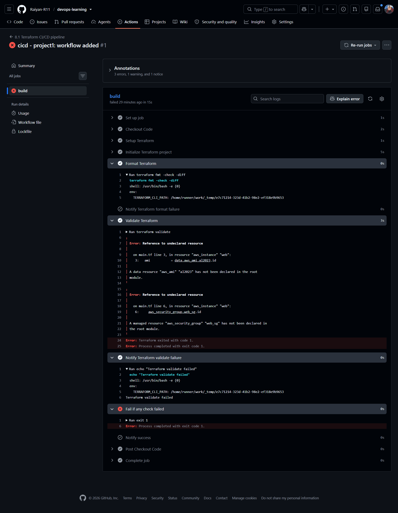
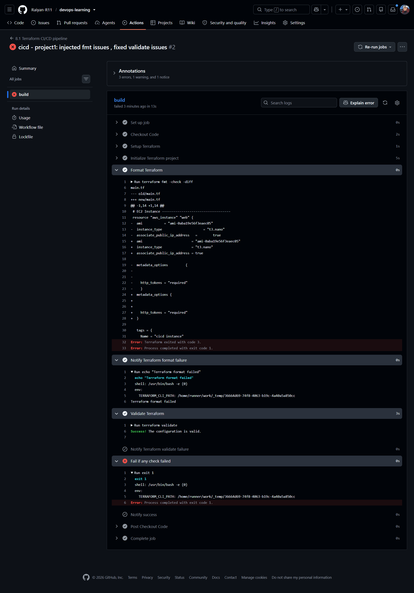
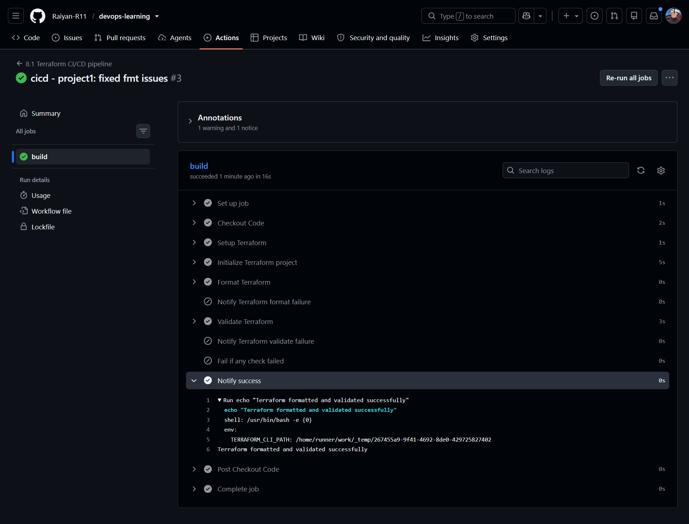

# Project 1: Check Terraform with GitHub Actions

A GitHub Actions workflow checks the formatting and validity of a small Terraform example on every push that changes it. The assignment brief is in [description.md](description.md).

## What's here

- [main.tf](main.tf): one EC2 instance, used as the code under test.
- [cicd-p1.yaml](../../.github/workflows/cicd-p1.yaml): the workflow. It runs on pushes that change `8-cicd/Project1/**` or the workflow file itself.

Nothing is deployed. The workflow never runs `plan` or `apply`, so no cloud resources are created.

## How the workflow runs

1. Check out the code, install Terraform, and run `terraform init`.
2. Run `terraform fmt -check -diff`, which reports formatting problems without rewriting files.
3. Run `terraform validate`, which checks the configuration is internally valid.
4. Fail the job if either check failed.

Both checks use `continue-on-error: true`, so a formatting failure does not stop `validate` from running. One run reports every problem, and the `Fail if any check failed` step still marks the job as failed.

## Results

| Run | Commit | `fmt` | `validate` | Result |
| --- | --- | --- | --- | --- |
| #1 | `5414a9a` | Pass | Fail | Failed |
| #2 | `2341038` | Fail | Pass | Failed |
| #3 | `4ebfda0` | Pass | Pass | Passed |

### Run #1: validate failure

`main.tf` referenced `data.aws_ami.al2023` and `aws_security_group.web_sg`, and neither was declared in the file. The formatting was fine, so only `validate` caught this.

### Run #2: deliberate format failure

With the references fixed, I added bad spacing to `main.tf` on purpose. `validate` passed, but `fmt -check` failed with exit code 3 and printed the diff.

### Run #3: passing run

After fixing the formatting, both checks passed and the failure steps were skipped.

## What the checks catch

| Check | Catches | Does not catch |
| --- | --- | --- |
| `terraform fmt -check` | Style that differs from the canonical format, such as spacing and alignment | Anything about whether the code works |
| `terraform validate` | Internal errors, such as undeclared references and invalid arguments | Problems that need AWS to detect, such as an AMI ID that does not exist, missing permissions, or quota limits |

Runs #1 and #2 show why both are useful: each failed a check the other passed.
