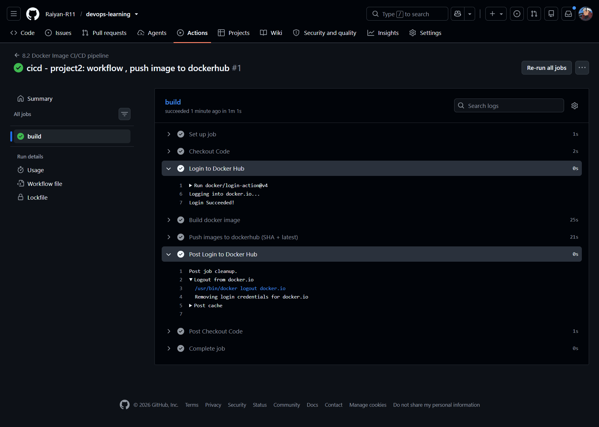
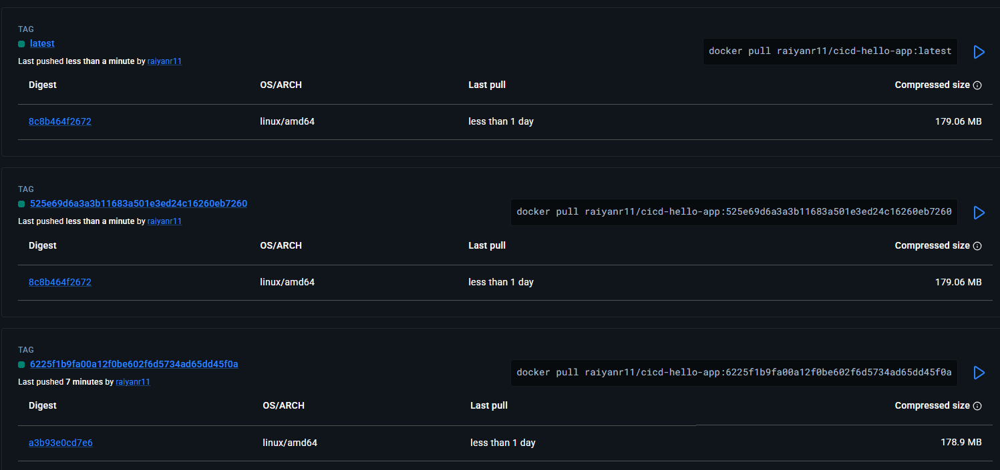

# Project 2: Build and push a Docker image with GitHub Actions

A GitHub Actions workflow builds a Docker image of a small Flask app and pushes it to Docker Hub on every push that changes it. The assignment brief is in [documentation.md](documentation.md).

## What's here

- [app.py](app.py): a Flask app on port 5002 that returns the MySQL server version. It expects a MySQL container reachable as `mydb`.
- [Dockerfile](Dockerfile): builds the app image from `python:3.8-slim`.
- [cicd-p2.yaml](../../.github/workflows/cicd-p2.yaml): the workflow. It runs on pushes that change `8-cicd/Project2/**` or the workflow file itself.

The workflow stops once the image is in the registry. It does not deploy or run the container.

## How the workflow runs

1. Check out the code.
2. Log in to Docker Hub with `docker/login-action`.
3. Build the image once with two tags: the commit SHA and `latest`.
4. Push both tags with `docker push -a`.

## Authentication

| Value | Stored as | Why |
| --- | --- | --- |
| `DOCKERHUB_USERNAME` | Repository variable (`vars.`) | Not sensitive, so it can appear in logs |
| `DOCKERHUB_TOKEN` | Repository secret (`secrets.`) | A Docker Hub personal access token, encrypted by GitHub and masked as `***` in logs |

Neither value is in the repository. Both are set under **Settings → Secrets and variables → Actions**. The login action removes the credentials from the runner in its post-job cleanup step.

## Image tags

| Tag | Points to | Changes on each push? |
| --- | --- | --- |
| `<commit SHA>` | The image built from that exact commit | No. Each push adds a new SHA tag and old ones stay. |
| `latest` | The most recent build | Yes. It moves to the newest image. |

A SHA tag links an image to its source code: `git checkout <sha>` shows exactly what was built. Old SHA tags stay in the registry, so rolling back means pulling an earlier tag.

## Results

Run #1 (commit `6225f1b`) succeeded in 1m 1s. Login, build and push all passed.

Docker Hub shows the tags for `raiyanr11/cicd-hello-app`. `latest` and `525e69d…` share digest `8c8b464f2672`, so they are the same image. The older `6225f1b…` tag keeps its own digest (`a3b93e0cd7e6`), which is what makes rolling back possible.

